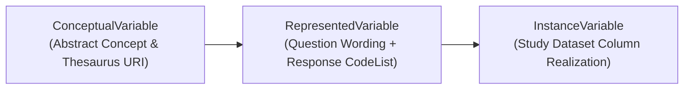
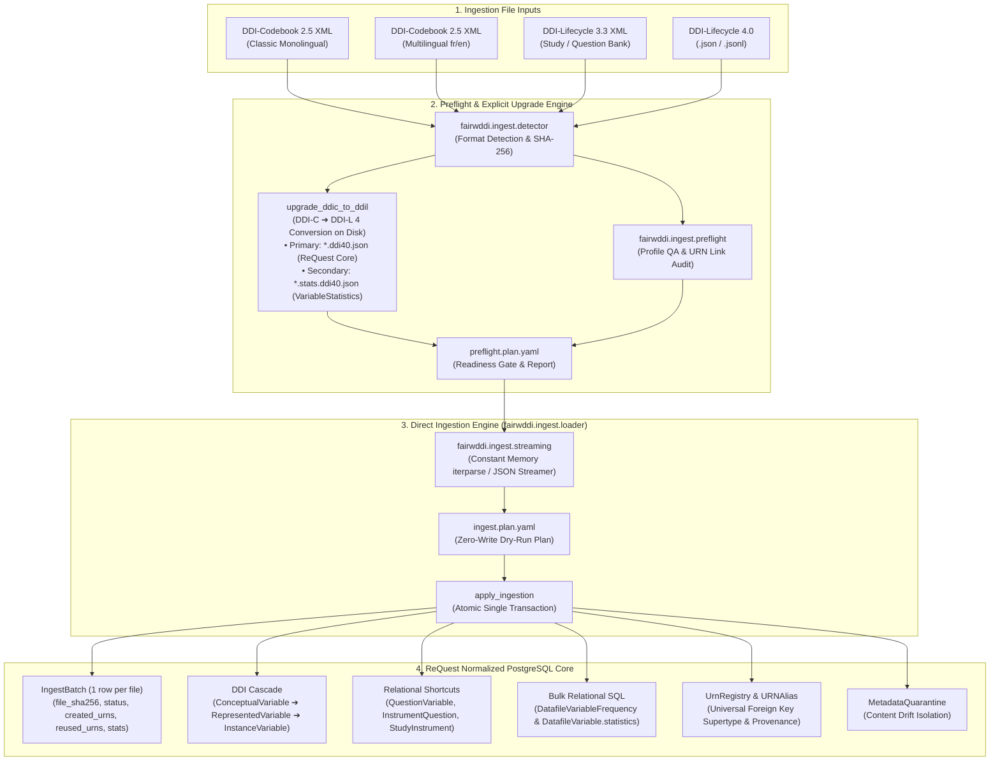
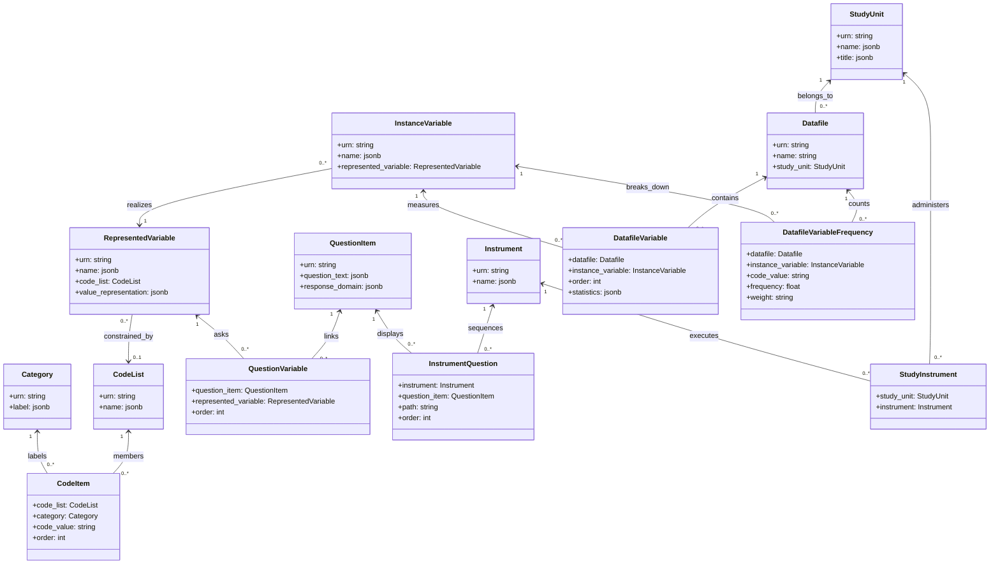
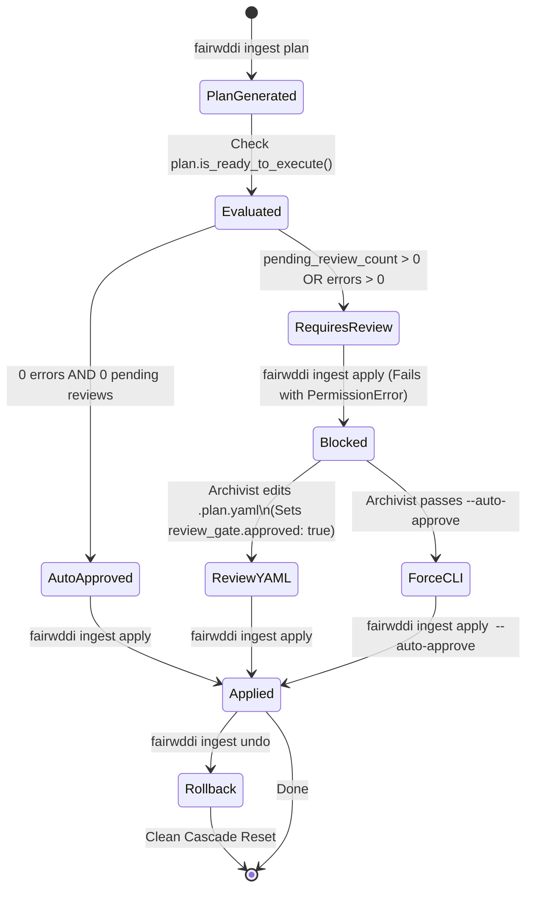

# Technical Specification — Phase 2 Direct Ingestion Architecture

> **Project:** FAIRwDDI WP3 ST3 — Implementation of DDI Architecture for ReQuest  
> **Organization:** Centre des Données Socio-Politiques (CDSP), Sciences Po / CNRS  
> **Target Subsystem:** [`fairwddi.ingest`](file:///Users/pascal/git-plgah/fairwddi-lifecycle/src/fairwddi/ingest/__init__.py)  
> **Status:** Technical Specification Deliverable  

---

## 1. Executive Summary & Core Principles

The **Phase 2 Ingestion Subsystem** transforms heterogeneous survey metadata—originating from legacy DDI-Codebook 2.5 (monolingual or bilingual), DDI-Lifecycle 3.3 XML, or modern DDI-Lifecycle 4.0 (COGS JSON/JSONL)—into a clean, standard-agnostic, relational question-bank core in PostgreSQL.

The architecture enforces the canonical DDI variable cascade:

$$\text{ConceptualVariable} \longrightarrow \text{RepresentedVariable} \longrightarrow \text{InstanceVariable}$$



### 1.1 Architectural Evolution: Direct File-to-Core Streaming vs. Database Staging

During Phase 1, an intermediate database staging model was evaluated (`StagedImport` and `StagedResourceNode`). In that preliminary design, raw file elements were parsed into intermediate PostgreSQL rows (`raw_urn`, `raw_value` JSONB) before undergoing a secondary "promotion" pass into core tables. 

Engineering audits and benchmarking revealed three major liabilities in intermediate database staging:
1. **Severe Storage Bloat:** Duplicating thousands of complete XML/JSON element fragments as JSONB in PostgreSQL doubled table and WAL storage requirements without operational benefit.
2. **Artificial Relational Detours for Statistics:** Non-resource relational rows—specifically descriptive summary statistics (`DatafileVariable.statistics`) and categorical response frequencies (`DatafileVariableFrequency`)—had to be forced through JSONB payloads before being reconstituted as relational SQL rows.
3. **Double Parsing & Write Latency:** Writing to staging tables, flushing transactions, and re-reading from database rows added unnecessary I/O overhead compared to streaming directly from disk in constant memory.

**Phase 2 Architecture Resolution:**
The intermediate database staging tables were **eliminated entirely**. They are replaced with a **direct file-to-core-tables streaming pipeline** backed by a lightweight receipt model: [`IngestBatch`](file:///Users/pascal/git-plgah/fairwddi-lifecycle/src/fairwddi/models/infrastructure.py#L148-L192) (`request_ddi_ingestbatch`).



### 1.2 Core Architectural Principles

1. **Lightweight Profile Guarantee:** The core schema models only the essential entities of the ReQuest question bank (`StudyUnit`, `Instrument`, `QuestionItem`, `Category`, `CodeList`, `Code`, `ConceptualVariable`, `RepresentedVariable`, `InstanceVariable`, `Datafile`). Monolithic DDI packaging constructs (`DDIInstance`, `ResourcePackage`, `ProcessingEventScheme`, `Archive`) are pruned during ingestion.
2. **Zero-Write Dry-Run Ingestion Plans:** The planning step (`plan_ingestion`) reads the source file directly from disk, normalizes nodes, checks existing identities against [`UrnRegistry`](file:///Users/pascal/git-plgah/fairwddi-lifecycle/src/fairwddi/models/infrastructure.py#L14-L44) and content hashes in PostgreSQL, and generates an [`IngestPlan`](file:///Users/pascal/git-plgah/fairwddi-lifecycle/src/fairwddi/ingest/plan.py#L78-L150) serialized to YAML and Markdown with **zero database mutations**.
3. **Review-Gated Mutation:** Any unresolved collision, content drift, or structural warning flags the plan as `requires_review = True`. Execution is blocked unless explicitly approved in the plan YAML (`review_gate.approved = True`) or overridden via `--auto-approve`.
4. **Single-Row Receipts (`IngestBatch`):** Each ingested file is recorded as exactly one receipt row in `request_ddi_ingestbatch`. It stores the file's SHA-256 fingerprint, source format, file path, status, and JSON arrays of created URNs, reused URNs, registered aliases, and entity counts.
5. **Direct Bulk SQL Frequency Insertion:** Categorical frequency counts (`<catStat>` / `CategoryStatistics`) and summary metrics (`<sumStat>` / `SummaryStatistic`) bypass JSONB and are written directly to [`DatafileVariableFrequency`](file:///Users/pascal/git-plgah/fairwddi-lifecycle/src/fairwddi/models/dataset.py#L350-L408) using bulk SQL inserts (`bulk_create(batch_size=1000)`).
6. **Universal URN Supertype Lifecycle (`UrnRegistry`):** All core DDI tables inherit from [`DDIIdentifiable`](file:///Users/pascal/git-plgah/fairwddi-lifecycle/src/fairwddi/models/base.py#L11-L164), which automatically upserts into `request_ddi_urnregistry(urn)` before child record creation. Foreign keys cascade from `UrnRegistry`, ensuring referential integrity and clean cascading deletions.
7. **One-Click Atomic Rollback (`undo_ingestion`):** Using the `created_urns` recorded in `IngestBatch`, `undo_ingestion` deletes newly minted `UrnRegistry` records in a single atomic transaction. PostgreSQL cascades the delete to all child tables, shortcut tables, and frequency rows, resetting the batch status to `undone`.
8. **Metadata Drift Quarantine:** When an incoming resource matches an existing canonical URN but exhibits a conflicting SHA-256 content fingerprint, the record is quarantined in [`MetadataQuarantine`](file:///Users/pascal/git-plgah/fairwddi-lifecycle/src/fairwddi/models/infrastructure.py#L86-L145) rather than silently overwriting the bank record.
9. **Decoupled Architecture for Empirical Statistics:** In standard DDI 4.0 and DDI-Lifecycle, `Variable`, `CodeList`, `Category`, and `QuestionItem` represent reusable, survey-agnostic metadata. Empirical observation statistics (frequencies, weighted counts, and numeric summaries) are dataset-specific. Upgrades decouple these into a primary question bank file (`*.ddi40.json`) and a dedicated secondary file (`*.stats.ddi40.json`) containing native `VariableStatistics` structures linked to parent variable URNs.
10. **Deduplication & Reduction Metrics:** When upgrading DDI-C files (`--harmonize-codes`), the engine computes exact deduplication metrics (raw counts, duplicates removed, and percentage reduction) for both code lists and categories, outputting these directly into CLI summary tables and Markdown upgrade reports.
11. **Declarative Quality Profiling:** Stage 1 preflight evaluates incoming DDI-C files against configurable YAML quality profiles (e.g., `profiles/request.ddic.yaml`), enforcing required elements (variables required as fatal errors) and recommending archival best practices (question items as warnings) with weighted quality scorecards.

---

## 2. Package Architecture (`fairwddi.ingest`)

The Phase 2 ingestion code lives in [`src/fairwddi/ingest/`](file:///Users/pascal/git-plgah/fairwddi-lifecycle/src/fairwddi/ingest/__init__.py). It is structured into specialized, decoupled modules:

```
src/fairwddi/ingest/
├── __init__.py           # Unified public API exports
├── detector.py           # Format identification (DDI-C, DDI-L 3.3/4.0) & SHA-256 hashing
├── profiles.py           # Declarative import profile loader (request.yaml, all_ddi.yaml)
├── streaming.py          # Low-memory XML iterparse, JSON, and JSONL streaming
├── plan.py               # IngestPlan, PlanActionItem, PlanIssue, ReviewGate schemas
├── preflight.py          # Preflight checks, profile QA, and DDI-C -> DDI-L disk conversion
├── loader.py             # Direct file-to-core ingestion engine, frequencies & undo
├── comparator.py         # Multi-tier cross-survey similarity comparison & candidate discovery
├── harmonizer.py         # Review-gated harmonization execution, URNAlias, & rollback
└── pipeline.py           # End-to-end multi-stage pipeline runner (preflight -> ingest -> harmonize)
```

### Module Responsibilities

| Module | Primary Functions & Classes | Responsibility |
| :--- | :--- | :--- |
| [`detector.py`](file:///Users/pascal/git-plgah/fairwddi-lifecycle/src/fairwddi/ingest/detector.py) | `detect_metadata_format`, `compute_file_sha256`, `MetadataFormatInfo` | Inspects file signatures, XML namespaces, and root tags to determine standard, version, serialization, and flavor. Computes file-level SHA-256 digests. |
| [`profiles.py`](file:///Users/pascal/git-plgah/fairwddi-lifecycle/src/fairwddi/ingest/profiles.py) | `load_profile`, `list_available_profiles`, `ImportProfile`, `ImportStrategies` | Loads declarative YAML/JSON profiles controlling resource inclusion, exclusion, reference resolution, and collision handling. |
| [`streaming.py`](file:///Users/pascal/git-plgah/fairwddi-lifecycle/src/fairwddi/ingest/streaming.py) | `stream_resources`, `stream_ddi_c_xml`, `stream_ddi_l_xml`, `stream_ddi_l_json`, `stream_ddi_l_jsonl`, `RawResourceNode` | Streams metadata documents fragment-by-fragment without loading full trees into memory. Emits unified `RawResourceNode` instances. |
| [`plan.py`](file:///Users/pascal/git-plgah/fairwddi-lifecycle/src/fairwddi/ingest/plan.py) | `IngestPlan`, `PlanActionItem`, `PlanIssue`, `ReviewGate` | Pydantic v2 models representing review-gated plans and reports across all stages. Handles YAML/Markdown serialization and approval verification. |
| [`preflight.py`](file:///Users/pascal/git-plgah/fairwddi-lifecycle/src/fairwddi/ingest/preflight.py) | `run_preflight_check`, `upgrade_ddic_to_ddil`, `_resolve_ddic_profile` | Verifies file readiness, audits URNs, evaluates custom DDI-C quality profiles (e.g. `request.ddic.yaml`), and converts DDI-C files to DDI-L 4.0 on disk with code list deduplication tracking and decoupled `*.stats.ddi40.json` companion files. |
| [`loader.py`](file:///Users/pascal/git-plgah/fairwddi-lifecycle/src/fairwddi/ingest/loader.py) | `plan_ingestion`, `apply_ingestion`, `undo_ingestion`, `list_ingest_batches`, `get_ingest_batch_status`, `compute_resource_hashes` | The core direct ingestion engine. Plans and applies streaming insertion into PostgreSQL core tables, bulk loads frequencies from both inline and dedicated `VariableStatistics` structures, records `IngestBatch` receipts, and performs atomic rollbacks. |
| [`comparator.py`](file:///Users/pascal/git-plgah/fairwddi-lifecycle/src/fairwddi/ingest/comparator.py) | `compare_batch`, `discover_candidates` | Evaluates similarities across six tiers (`EXACT`, `FACET_EXACT`, `MULTILINGUAL_OVERLAP`, `SUBSTANTIVE_PERMUTATION`, `CATEGORIES_EXACT_CODES_DIFFERENT`, `SYNTACTIC_SIMILAR`). |
| [`harmonizer.py`](file:///Users/pascal/git-plgah/fairwddi-lifecycle/src/fairwddi/ingest/harmonizer.py) | `plan_harmonization`, `apply_harmonization`, `undo_harmonization` | Executes review-gated harmonization actions (multilingual label merging, `URNAlias` consolidation, `RepresentedVariable` relinking, `SemanticRelationship` creation) and snapshots rollbacks in `EventLog`. |
| [`pipeline.py`](file:///Users/pascal/git-plgah/fairwddi-lifecycle/src/fairwddi/ingest/pipeline.py) | `run_ingestion_pipeline` | Orchestrates the end-to-end pipeline (`preflight` $\rightarrow$ optional `upgrade` $\rightarrow$ `ingest` $\rightarrow$ optional `harmonize`). |

---

## 3. Data Structures & Persistent Identification

### 3.1 Persistent Canonical URN Format

All resources managed by FAIRwDDI carry persistent canonical URNs:

$$\text{urn:ddi:}\langle\text{agency}\rangle\text{:}\langle\text{identifier}\rangle\text{:}\langle\text{version}\rangle$$

Examples:
- Category: `urn:ddi:fr.cdsp:cat_bpf_q01_yes:1.0.0`
- QuestionItem: `urn:ddi:fr.cdsp:qi_trust_parliament:1.0.0`
- RepresentedVariable: `urn:ddi:fr.cdsp:rv_trust_parliament:1.0.0`
- InstanceVariable: `urn:ddi:fr.cdsp:iv_bpf2007_q01:1.0.0`

Non-canonical external URNs (e.g. `raw:closer:qi:1234` or random UUIDs) are parsed via `parse_ddi_urn()`. When an external resource is ingested, its original raw URN is preserved in `URNAlias(alias_urn=..., canonical_urn=...)`.

### 3.2 Content Fingerprinting (`compute_resource_hashes`)

To detect metadata changes, detect drift, and identify deduplication candidates, `fairwddi.ingest.loader` computes SHA-256 digests across normalized JSON representations:

```python
def compute_resource_hashes(resource_type: str, normalized_payload: dict[str, Any]) -> dict[str, str]:
    canonical_repr = json.dumps(_sort_nested_structures(normalized_payload), sort_keys=True, ensure_ascii=False)
    digest = hashlib.sha256(canonical_repr.encode("utf-8")).hexdigest()
    return {
        "content": f"sha256:{digest}",
        "primary": f"sha256:{digest}",
        "sha256": digest,
    }
```

The canonical hash is stored in `DDIResource.hashes["content"]` and indexed via GIN/B-tree in PostgreSQL.

### 3.3 The `UrnRegistry` Supertype Master Table

Referential integrity across polymorphic DDI relationships is maintained via `request_ddi_urnregistry`:

```sql
CREATE TABLE IF NOT EXISTS request_ddi_urnregistry (
    urn VARCHAR(512) PRIMARY KEY,
    resource_type VARCHAR(64) NOT NULL,
    status VARCHAR(32) NOT NULL DEFAULT 'active',
    extended_attributes JSONB NOT NULL DEFAULT '[]'::jsonb,
    created_at TIMESTAMPTZ NOT NULL DEFAULT CURRENT_TIMESTAMP,
    updated_at TIMESTAMPTZ NOT NULL DEFAULT CURRENT_TIMESTAMP
);
CREATE INDEX IF NOT EXISTS req_ddi_urn_reg_status_idx ON request_ddi_urnregistry (status);
CREATE INDEX IF NOT EXISTS req_ddi_urn_reg_type_idx ON request_ddi_urnregistry (resource_type);
```

Every child table references `request_ddi_urnregistry(urn) ON DELETE CASCADE`. When `DDIIdentifiable.save()` executes, it automatically pre-registers or upserts its URN in `UrnRegistry`.

### 3.4 The `IngestBatch` Model (`request_ddi_ingestbatch`)

To avoid per-node database staging overhead, `IngestBatch` records the receipt of each ingested file:

```sql
CREATE TABLE IF NOT EXISTS request_ddi_ingestbatch (
    id BIGSERIAL PRIMARY KEY,
    source_format VARCHAR(64) NOT NULL,
    file_name VARCHAR(255) NOT NULL,
    file_sha256 VARCHAR(64) NOT NULL,
    file_path TEXT NULL,
    status VARCHAR(32) NOT NULL DEFAULT 'completed',
    options JSONB NOT NULL DEFAULT '{}'::jsonb,
    created_urns JSONB NOT NULL DEFAULT '[]'::jsonb,
    reused_urns JSONB NOT NULL DEFAULT '[]'::jsonb,
    created_aliases JSONB NOT NULL DEFAULT '[]'::jsonb,
    stats JSONB NOT NULL DEFAULT '{}'::jsonb,
    created_at TIMESTAMPTZ NOT NULL DEFAULT CURRENT_TIMESTAMP,
    updated_at TIMESTAMPTZ NOT NULL DEFAULT CURRENT_TIMESTAMP
);
CREATE INDEX IF NOT EXISTS req_ddi_ib_sha256_idx ON request_ddi_ingestbatch (file_sha256);
CREATE INDEX IF NOT EXISTS req_ddi_ib_status_idx ON request_ddi_ingestbatch (status);
```

---

## 4. DDI-L to ReQuest Relational Mapping & Shortcut Resolution

DDI-Lifecycle specifications define deeply nested, multi-hop trees for question flows, interviewer instructions, and variable statistics. To optimize query performance in the ReQuest web interface and Elasticsearch indexers, `fairwddi.ingest.loader` maps these structures to relational shortcuts:



### 4.1 Shortcut Resolution Details

1. **`Variable` Synthesis (`RepresentedVariable` + `InstanceVariable`):**
   - In DDI-Codebook and flat DDI-L files, a variable combines representation and dataset column properties.
   - The loader synthesizes a reusable `RepresentedVariable` (or matches an existing one via content hash) containing the question text, response code list, and value representation.
   - It then creates the study-specific `InstanceVariable` pointing to that `RepresentedVariable`.
2. **`QuestionVariable` Shortcut:**
   - Associates `QuestionItem` with `RepresentedVariable` and stores the sequence `order`.
   - In DDI-L 3.3, this resolves `QuestionReference` links inside `Variable` or `QuestionConstruct`.
3. **`InstrumentQuestion` & `StudyInstrument` Flattening:**
   - DDI-L instruments define questionnaires as nested trees (`Sequence` $\rightarrow$ `IfThenElse` $\rightarrow$ `Loop` $\rightarrow$ `QuestionConstruct` $\rightarrow$ `QuestionReference`).
   - The loader traverses the control constructs, flattens the hierarchy into ordered items, and inserts rows into `InstrumentQuestion(instrument, question_item, path="/Instrument/Sequence/1", order=n)` and `StudyInstrument(study_unit, instrument)`.
4. **Direct Frequency Loading (`DatafileVariableFrequency`):**
   - Extracted from `<catStat>` (DDI-C), inline `UserAttributePair` (DDI-L 4), or strongly-typed `VariableStatistics` (DDI-L 3.3 and DDI 4.0 companion files).
   - Resolves `code_value`, weighted counts, and parent `InstanceVariable`.
   - Bulk-inserted via `DatafileVariableFrequency.objects.bulk_create(..., batch_size=1000)`.
5. **Summary Statistics (`DatafileVariable.statistics`):**
   - Populated with key-value pairs (e.g. `{"valid": 1180, "invalid": 20, "mean": 2.45, "stddev": 0.82}`) extracted from `<sumStat>`, `SummaryStatisticType`, or `VariableStatistics`.
6. **Decoupled Secondary Statistics Ingestion:**
   - In accordance with DDI 4.0 principles, empirical frequencies and summary statistics may be streamed either inline or from a paired companion file (`<dataset>.stats.ddi40.json`).
   - The loader automatically reconciles `VariableStatistics.VariableReference` URNs back to the corresponding `InstanceVariable` in the primary dataset, maintaining full data integrity without bloating reusable question bank records.

---

## 5. Review-Gated Plan Lifecycle (`IngestPlan`)

Every stage produces a machine-readable plan (`.plan.yaml`) and a human-readable report (`.report.md`):



### Plan Action Types (`PlanActionItem.action`)

- `create`: Resource is new to the database; it will be inserted into its core table and registered in `UrnRegistry`.
- `reuse`: Canonical URN already exists with an identical content hash; the existing record is reused with zero mutations.
- `alias`: Resource content matches an existing record under a different URN; a `URNAlias` record will be created to map the incoming URN to the canonical database URN.
- `quarantine`: Resource URN matches an existing record, but the content hash differs (`ING-DRIFT-001`). The incoming payload is isolated in `MetadataQuarantine`.

---

## 6. Comparison & Harmonization Pipeline (`compare` & `harmonize`)

Once resources are ingested, Phase 2 provides cross-survey comparison and review-gated harmonization:

### 6.1 Multi-Tier Similarity Engine

[`discover_candidates`](file:///Users/pascal/git-plgah/fairwddi-lifecycle/src/fairwddi/ingest/comparator.py#L336-L398) compares resources across six ranked tiers:

| Tier | Match Type | Confidence | Recommended Action | Requires Review |
| :--- | :--- | :---: | :--- | :---: |
| 1 | `EXACT` | 1.00 | `alias` (Register URNAlias) | No |
| 2 | `FACET_EXACT` | 0.95 | `alias` (Identical normalized text across present languages) | No |
| 3 | `MULTILINGUAL_OVERLAP` | 0.90 – 0.92 | `merge_multilingual` (Enrich target with missing translations) | Yes |
| 4 | `SUBSTANTIVE_PERMUTATION` | 0.88 | `link_semantic` (CodeLists share identical non-missing categories) | Yes |
| 5 | `CATEGORIES_EXACT_CODES_DIFFERENT` | 0.85 | `link_semantic` (Identical category labels, different numeric codes) | Yes |
| 6 | `SYNTACTIC_SIMILAR` | 0.75 – 0.94 | `link_semantic` (High normalized Levenshtein/difflib string ratio) | Yes |

### 6.2 Harmonization Execution & Rollback

- **Multilingual Merging (`merge_multilingual`):** Combines JSONB dictionaries across languages. Missing translation keys from the source are merged into the target entity, and updated content hashes are recomputed.
- **Cascade Relinking (`alias` / `harmonize`):** Re-points downstream `InstanceVariable` rows from the source `RepresentedVariable` to the canonical target, consolidating cross-survey variables under a unified representation.
- **Semantic Relationship (`link_semantic`):** Creates an explicit RDF triple in `SemanticRelationship` (`skos:exactMatch` or `skos:closeMatch`).
- **Harmonization Rollback (`undo_harmonization`):** Before applying mutations, a snapshot of target fields (`label`, `description`, `question_text`, `hashes`) and repointed foreign keys is stored in `EventLog`. Reverting via `undo_harmonization(job_id)` restores original states and removes created aliases.
