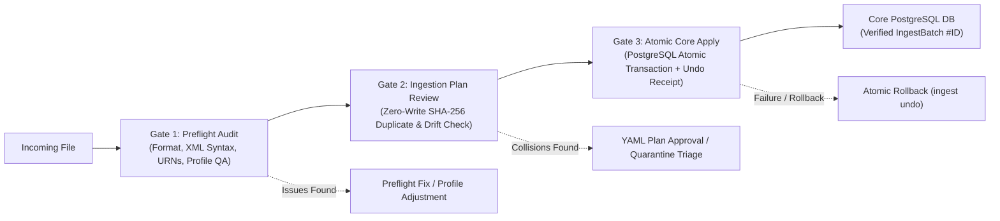
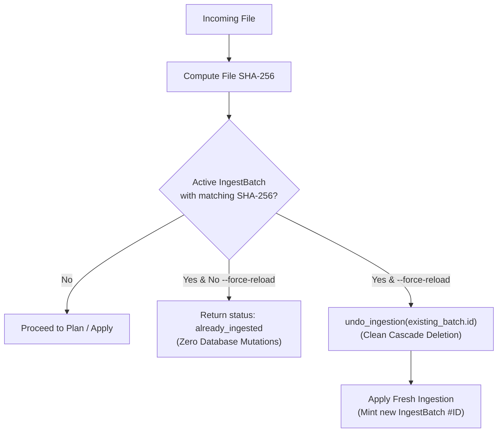
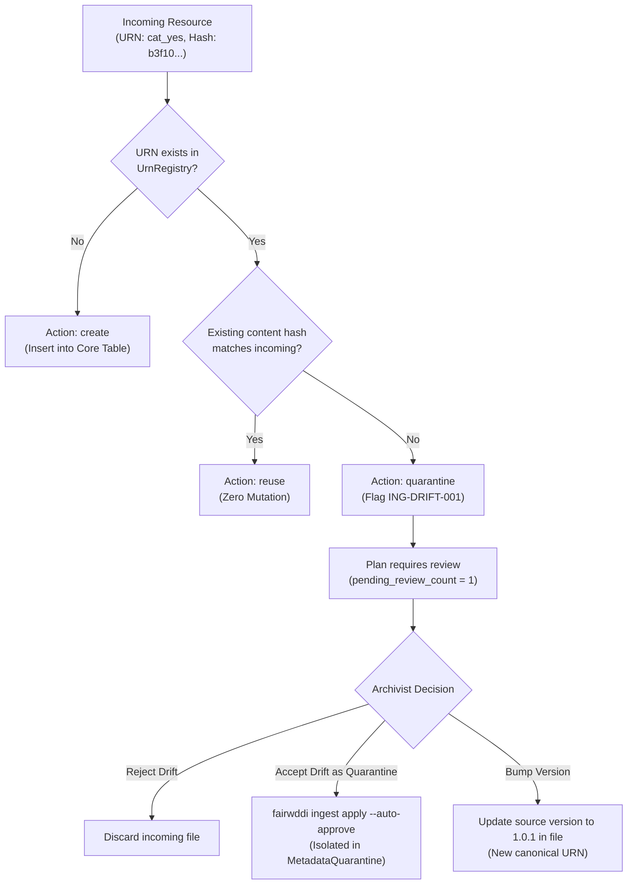

# QA & Troubleshooting Guide — Phase 2 Ingestion Issues

> **Project:** FAIRwDDI WP3 ST3 — Implementation of DDI Architecture for ReQuest  
> **Organization:** Centre des Données Socio-Politiques (CDSP), Sciences Po / CNRS  
> **Target Subsystem:** [`fairwddi.ingest`](file:///Users/pascal/git-plgah/fairwddi-lifecycle/src/fairwddi/ingest/__init__.py)  
> **Status:** Operational QA Deliverable  

---

## 1. Overview of Quality Assurance & Safety Gates

The FAIRwDDI Phase 2 ingestion architecture implements a **defensive, review-gated pipeline**. It prevents database corruption, duplicate uploads, and metadata drift through three consecutive safety barriers:



---

## 2. Preflight Stage Issues & Remedies

### Issue 2.1: File Format Unrecognized (`format: unknown`)

*Symptom:*
Running `fairwddi preflight check` yields:
```
Detected Format: unknown
Error: Unsupported file format or unparseable metadata structure.
```

*Root Cause:*
The file extension or XML root element namespace is not recognized by [`detect_metadata_format`](file:///Users/pascal/git-plgah/fairwddi-lifecycle/src/fairwddi/ingest/detector.py#L48-L73). 

*Diagnostic Steps:*
1. Run `head -n 20 <filename>` to inspect the root element and namespace declarations.
2. Verify that XML namespaces match supported standards:
   - DDI-Codebook 2.5: `xmlns="ddi:codebook:2_5"` or `<codeBook version="2.5">`
   - DDI-Lifecycle 3.3: `xmlns:d="ddi:datacollection:3_3"` or `xmlns="ddi:instance:3_3"`
   - DDI-Lifecycle 4.0: Top-level JSON with `"$type"` or `"items": [{"$type": "..."}]`
3. If the file is valid XML but lacks standard namespace bindings, pass an explicit format override during ingestion if supported, or fix the root namespace declaration.

---

### Issue 2.2: Missing Study Identification (`IDNo` / `titlStmt`)

*Symptom:*
Preflight flags warning:
```
[WARNING] [PRE-STUDY-001] Missing citation IDNo in stdyDscr. Fallback identifier will be synthesized.
```

*Impact:*
Without an explicit study ID, the system synthesizes a fallback URN based on the file SHA-256 fingerprint: `urn:ddi:fr.cdsp:study_<sha256_prefix>:1.0.0`. While valid, this may detach the dataset from the archive's persistent survey series.

*Remedy:*
1. In DDI-Codebook XML, ensure `<citation>` contains `<titlStmt><IDNo agency="fr.cdsp">STUDY_ID</IDNo></titlStmt>`.
2. When running `fairwddi preflight upgrade`, supply the explicit identifier:
   ```bash
   fairwddi preflight upgrade survey.xml --identifier CDSP_BPF_2007 --agency fr.cdsp
   ```

---

### Issue 2.3: Non-Canonical or Broken DDI URNs

*Symptom:*
Preflight reports issues with code `PRE-URN-001` or `PRE-URN-002`:
```
[WARNING] [PRE-URN-001] Element QuestionItem 'q01' does not use canonical URN syntax.
```

*How the System Handles It:*
[`parse_ddi_urn`](file:///Users/pascal/git-plgah/fairwddi-lifecycle/src/fairwddi/ingest/loader.py#L27-L49) normalizes raw IDs into standard four-part canonical URNs:
- Raw ID `q01` $\longrightarrow$ `urn:ddi:fr.cdsp:q01:1.0.0`
- Original raw identifier is mapped in `URNAlias(alias_urn="q01", canonical_urn="urn:ddi:fr.cdsp:q01:1.0.0")`.

*Remedy for Archivists:*
When upgrading DDI-C files, choose an appropriate `--id-strategy`:
- `content_hash`: Generates deterministic URNs from normalized content (recommended for reusable categories and questions).
- `hierarchical`: Derives URNs from survey name and variable name (`urn:ddi:agency:study_var:1.0.0`).
- `original`: Preserves original XML IDs if they are globally unique.

---

### Issue 2.4: Broken Internal References in DDI-L 3.3

*Symptom:*
Preflight reports:
```
[ERROR] [PRE-REF-001] QuestionReference in Variable 'V_TRUST' references non-existent QuestionItem 'qi_missing_01'.
```

*Impact:*
In DDI-L 3.3, a `Variable` may reference a `QuestionItem` that was omitted from the exported XML fragment.

*Remedy:*
1. Re-export the DDI-L 3.3 XML package with "Resolve External References" enabled in the source repository (e.g. Colectica / Dataverse).
2. If the missing resource cannot be recovered, the ingestion loader automatically isolates the variable's text from `<r:Label>` and synthesizes a localized `QuestionItem` to prevent question loss.

---

### Issue 2.5: Low Quality Score or Poor Quality Grade

*Symptom:*
Preflight summary displays:
```
Quality Score: 48.5 / 100
Quality Grade: D (POOR)
Pending Review Count: 14
```

*Causes Flagged by `ddil-profile`:*
1. **Empty / Placeholder Labels:** Variables or categories whose label is empty, whitespace, or placeholder text (e.g. `"."`, `"NA"`, `"Var 1"`).
2. **Missing Question Text:** Variables declaring a question reference, but the linked question item has no `<qstnLit>` content.
3. **Missing Category Labels:** Codelists with numeric codes (e.g. `1, 2, 3`) but no corresponding category labels.

*Remedy:*
1. Review the generated `.preflight.report.md` for the line-numbered list of offending elements.
2. Remediate source files in the source catalogue before ingestion, or pass `--auto-approve` if the legacy dataset is known to have sparse documentation.

---

### Issue 2.6: Multilingual Parity Gaps

*Symptom:*
```
[WARNING] [PRE-LANG-001] Declared languages ['fr', 'en'] exhibit asymmetric coverage:
  - QuestionItem: 12 items lack English translation.
  - Category: 45 categories lack English translation.
```

*Remedy:*
1. The ingestion engine safely ingests asymmetrical multilingual dictionaries (e.g. `label={"fr": "Oui"}` without an `"en"` key).
2. When the English translation file becomes available later, ingest it or run `fairwddi compare discover` $\rightarrow$ `fairwddi harmonize apply` to execute a `merge_multilingual` action, which enriches the existing French records with English labels.

---

### Issue 2.7: Profile Filtering Mismatches

*Symptom:*
Expected resources (such as `Instrument` or `Datafile`) are missing from the plan summary.

*Root Cause:*
The active import profile ([`profiles/request.yaml`](file:///Users/pascal/git-plgah/fairwddi-lifecycle/profiles/request.yaml)) explicitly excludes certain resource types (e.g., `Archive`, `VariableStatistics`, `QualityStandard`).

*Remedy:*
1. Check profile rules via CLI:
   ```bash
   fairwddi preflight profiles
   ```
2. If full DDI ingestion is needed without ReQuest profile pruning, use the `all_ddi` profile:
   ```bash
   fairwddi ingest plan metadata.xml --profile all_ddi
   ```

---

## 3. Ingestion Stage Issues & Remedies

### Issue 3.1: Duplicate File Ingestion Blocked (`already_ingested`)

*Symptom:*
Applying ingestion returns:
```
Notice: File already ingested in Batch #12. Use --force-reload to replace.
```



*Root Cause:*
The file's SHA-256 cryptographic hash matches an existing record in `request_ddi_ingestbatch` whose status is `completed` or `quarantined`.

*Remedy:*
- **If the file was re-uploaded accidentally:** No action required; the existing batch protects the database from duplicate insertion.
- **If the file needs to be reloaded:** Supply `--force-reload`. The system will automatically trigger `undo_ingestion()` on the old batch, deleting previously created entities, and perform a clean re-ingestion:
  ```bash
  fairwddi ingest apply survey.xml --force-reload
  ```

---

### Issue 3.2: Content Drift Detected (`ING-DRIFT-001` & Quarantine)

*Symptom:*
The ingestion plan reports:
```
[WARNING] [ING-DRIFT-001] Content drift detected on existing URN 'urn:ddi:fr.cdsp:cat_yes:1.0.0':
  existing=sha256:5b5abdf1217d, incoming=sha256:b3f1069c6a52.
Pending Review Items: 1
```



*Root Cause:*
An incoming element declares a canonical URN that is already registered in `UrnRegistry`, but its contents (e.g. category label or question wording) have been modified in the source file without incrementing the DDI version component.

*How Quarantine Protects the Database:*
- The existing record in PostgreSQL is **never overwritten**.
- When applied (with approval), the conflicting payload is stored in `request_ddi_metadataquarantine`:
  ```sql
  SELECT id, incoming_urn, conflict_type, incoming_content_hash, existing_content_hash
  FROM request_ddi_metadataquarantine;
  ```
- The `IngestBatch` receipt is flagged with `status = "quarantined"`.

*Remedy:*
1. **If the change is an intentional new version:** Update the version in the source file (e.g. from `1.0.0` to `2.0.0`) so it receives a distinct canonical URN.
2. **If the change is a translation addition:** Ingest the file, then use `fairwddi harmonize` to merge the multilingual text onto the existing canonical URN.

---

### Issue 3.3: Execution Blocked by Review Gate (`PermissionError`)

*Symptom:*
Executing `fairwddi ingest apply` fails with:
```
PermissionError: Ingestion plan 'ingest-survey-7a2b9c' has 2 pending review item(s).
Approve the plan YAML (review_gate.approved: true) or pass --auto-approve.
```

*Remedy:*
Option A — **Human-in-the-Loop Review (Recommended):**
1. Open the plan YAML file (e.g. `./ingest_output/survey.ingest.plan.yaml`).
2. Inspect the `issues` and `actions` sections marked with `requires_review: true`.
3. Set `review_gate.approved: true` and specify `reviewer`:
   ```yaml
   review_gate:
     approved: true
     reviewer: "Archivist QA Lead"
     notes: "Reviewed drift items; confirmed acceptable for quarantine."
   ```
4. Re-run `fairwddi ingest apply ./ingest_output/survey.ingest.plan.yaml`.

Option B — **Automated Script Override:**
If executing in an unattended CI/CD pipeline, pass the bypass flag:
```bash
fairwddi ingest apply ./ingest_output/survey.ingest.plan.yaml --auto-approve
```

---

### Issue 3.4: Transaction Failure & Partial Ingestion Recovery

*Symptom:*
An unhandled exception occurs mid-ingestion (e.g. network disconnect or disk full).

*Guarantee & Recovery:*
- Ingestion executes inside a single atomic block: `with transaction.atomic():`.
- If an unhandled exception occurs, PostgreSQL rolls back all inserts completely. No orphaned records remain in `UrnRegistry` or core tables.
- If an `IngestBatch` was successfully committed but needs removal for any reason, invoke 1-click rollback:
  ```bash
  fairwddi ingest undo <batch_id>
  ```

---

## 4. Comparison & Harmonization Issues & Remedies

### Issue 4.1: False-Positive Candidate Matches in Discovery

*Symptom:*
`fairwddi compare discover` suggests linking two questions that have high string similarity but different substantive meanings:
```
Type: QuestionItem | Match Tier: SYNTACTIC_SIMILAR | Conf: 0.82
Source: urn:ddi:fr.cdsp:qi_trust_parliament:1.0.0
Target: urn:ddi:fr.cdsp:qi_trust_government:1.0.0
```

*Why It Happens:*
Tier 6 (`SYNTACTIC_SIMILAR`) uses normalized string distance. Questions sharing significant phrasing (e.g. "Do you trust the...") will score $\ge 0.75$.

*Remedy:*
1. All `SYNTACTIC_SIMILAR` actions are flagged with `requires_review: true`.
2. Generate the harmonization plan:
   ```bash
   fairwddi harmonize plan --threshold 0.75 --output-dir ./harm_plans
   ```
3. Open `./harm_plans/<job_id>.harmonize.plan.yaml`.
4. Locate the incorrect action item and set `approved: false`:
   ```yaml
   - id: harm-0012
     action: link_semantic
     approved: false    # <--- Archivist rejects this action
     notes: "Rejected: Different political institutions."
   ```
5. Apply the approved plan:
   ```bash
   fairwddi harmonize apply ./harm_plans/<job_id>.harmonize.plan.yaml
   ```
   Items marked `approved: false` will be completely skipped.

---

### Issue 4.2: Reverting an Applied Harmonization Job

*Symptom:*
A previously applied harmonization job needs to be reverted because questions were merged incorrectly.

*Remedy:*
Every harmonization job records a target field snapshot and foreign key repointing log in `EventLog`. Execute 1-click harmonization undo:

```bash
fairwddi harmonize undo harmonize-batch42-c3d4e5
```

*What the Rollback Restores:*
1. Re-points all `InstanceVariable` records back to their original `RepresentedVariable`.
2. Restores original `label`, `description`, and `question_text` multilingual JSONB fields from the pre-merge snapshot.
3. Removes created `URNAlias` entries.
4. Deletes created `SemanticRelationship` triples.
5. Removes the `EventLog` record.

---

## 5. QA Verification Checklist

Before releasing ingested survey datasets to production or Elasticsearch indexing, archivists should complete this checklist:

| Verification Item | Command / Query | Expected Result |
| :--- | :--- | :--- |
| **IngestBatch Status** | `fairwddi ingest status <batch_id>` | `status = "completed"`, `quarantine_count = 0`. |
| **DDI Cascade Integrity** | `SELECT count(*) FROM request_ddi_instancevariable WHERE represented_variable_urn IS NULL;` | Exactly `0` (all instance variables linked). |
| **Question Association** | `SELECT count(*) FROM request_ddi_questionvariable;` | Matches or exceeds total `RepresentedVariable` count. |
| **Frequency Rows** | `SELECT count(*) FROM request_ddi_datafilevariablefrequency WHERE datafile_urn = '<df_urn>';` | Matches total categories across survey variables. |
| **Summary Statistics** | `SELECT count(*) FROM request_ddi_datafilevariable WHERE statistics = '{}'::jsonb;` | `0` for numeric/discrete survey variables. |
| **UrnRegistry Parity** | `SELECT count(*) FROM request_ddi_questionitem q LEFT JOIN request_ddi_urnregistry r ON q.urn = r.urn WHERE r.urn IS NULL;` | Exactly `0` (universal supertype referential integrity). |
