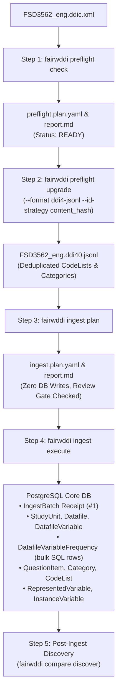
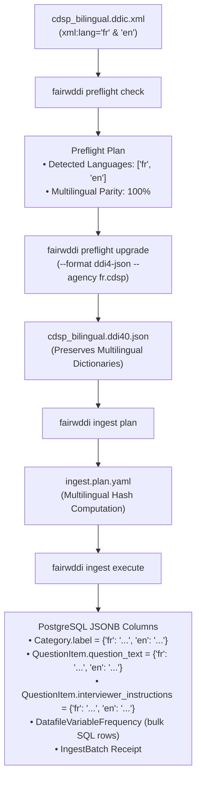
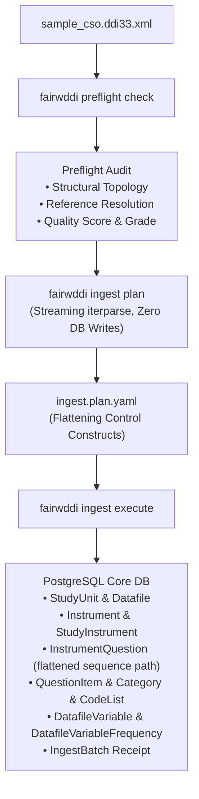
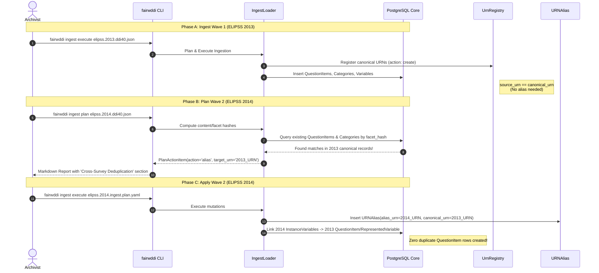
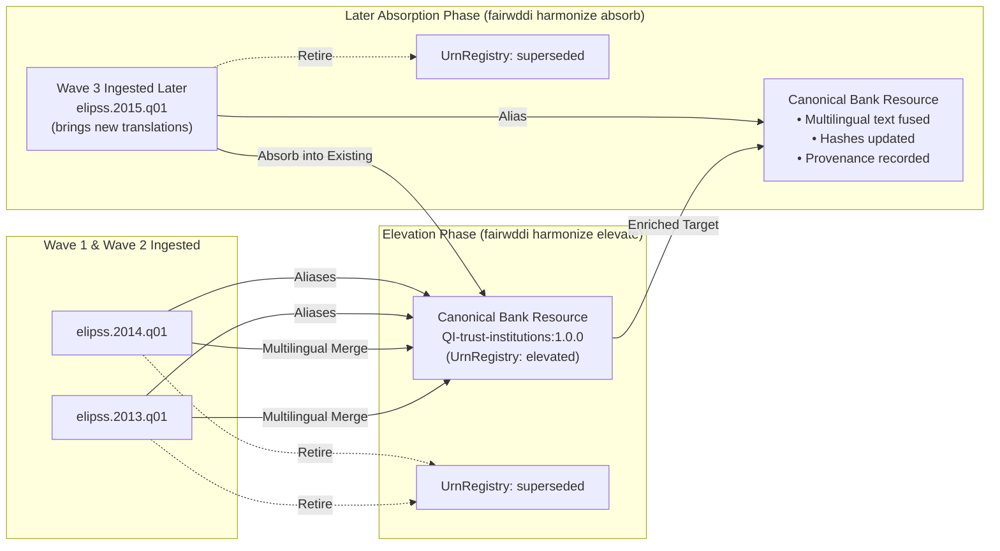

# Operational Guide — Phase 2 Ingestion Workflows

> **Project:** FAIRwDDI WP3 ST3 — Implementation of DDI Architecture for ReQuest  
> **Organization:** Centre des Données Socio-Politiques (CDSP), Sciences Po / CNRS  
> **Target Subsystem:** [`fairwddi.ingest`](file:///Users/pascal/git-plgah/fairwddi-lifecycle/src/fairwddi/ingest/__init__.py)  
> **Status:** Operational Research Deliverable  

---

## 1. Overview of Ingestion Use Cases

The FAIRwDDI Phase 2 ingestion engine supports three primary operational workflows:

1. **Workflow 1: DDI-Codebook Classic (Monolingual):** A standard DDI-C 2.5 XML file documenting one or more data files, with single-language question wordings, variable labels, and code categories.
2. **Workflow 2: DDI-Codebook Multilingual (Bilingual / Trilingual):** A DDI-C 2.5 XML file produced by the `ddi-toolkit` multilingual merge utility (`ddic-i18nmerge`), containing parallel `xml:lang` attributes on `<titl>`, `<labl>`, `<qstnLit>`, `<ivuInstr>`, and `<catgry>`.
3. **Workflow 3: DDI-Lifecycle 3.3 XML (Study Waves & Question Banks):** Complex DDI-L 3.3 XML containing maintainable schemes, question constructs, instruments, sequencing logic, and variable statistics.

---

## 2. Workflow 1: DDI-Codebook Classic (Monolingual)

### 2.1 Use Case & Preconditions
- **Input:** Standard DDI-Codebook 2.5 XML file (e.g. `FSD3562_eng.ddic.xml`).
- **Characteristics:** Monolingual metadata, flat variable listing (`<var>`), embedded question text (`<qstn>`), embedded category statistics (`<catStat>`), and dataset dimensions (`<fileDscr>`).
- **Target:** Upgrade to canonical DDI-L 4.0 on disk, synthesize `ConceptualVariable` $\rightarrow$ `RepresentedVariable` $\rightarrow$ `InstanceVariable`, bulk-insert frequency counts, and record an `IngestBatch` receipt.



### 2.2 Step-by-Step Execution

#### Step 1: Preflight Readiness Check
Audits the DDI-C XML structure, verifies XML well-formedness, inspects study identification, and checks if the file has already been ingested.

```bash
fairwddi preflight check tests/fixtures/FSD3562_eng.ddic.xml \
  --profile request \
  --output-dir ./ingest_output
```

*Expected Output:*
- Emits `./ingest_output/FSD3562_eng.ddic.preflight.plan.yaml` and `.report.md`.
- Summary reports: `specification: DDI-C`, `version: 2.5`, `is_multilingual: false`, `variable_count: 74`.
- If zero errors are reported, `is_ready_to_execute()` evaluates to `True`.

#### Step 2: Explicit DDI-C $\rightarrow$ DDI-L 4.0 Upgrade on Disk
Converts DDI-C into canonical DDI-Lifecycle 4.0 format. Categories and code lists sharing identical response options across variables are automatically deduplicated.

When empirical observation statistics (frequencies or summary statistics) are present, the upgrade engine produces **two decoupled files**:
1. **Primary Question Bank & Study File (`*.ddi40.json` / `*.ddi40.jsonl`):** Reusable `StudyUnit`, `LogicalProduct`, schemes, `QuestionItem`, `Variable`, `CodeList`, `Category`, and `PhysicalInstance` layout.
2. **Dedicated Secondary Statistics File (`*.stats.ddi40.json`):** Strongly-typed `VariableStatistics` elements documenting empirical observations (`TotalResponses`, `SummaryStatisticType`, and `UnfilteredCategoryStatisticsType`).

```bash
fairwddi preflight upgrade tests/fixtures/FSD3562_eng.ddic.xml \
  --output ./ingest_output/FSD3562_eng.ddi40.json \
  --format ddi4-json \
  --agency fi.fsd \
  --version 1.0.0 \
  --id-strategy hierarchical \
  --harmonize-codes
```

*Rich CLI Output Summary:*
```text
                         DDI-C to DDI-L Upgrade Summary                         
┏━━━━━━━━━━━━━━━━━━━━━━━━━━━┳━━━━━━━━━━━━━━━━━━━━━━━━━━━━━━━━━━━━━━━━━━━━━━━━━━┓
┃ Metric                    ┃ Value                                            ┃
┡━━━━━━━━━━━━━━━━━━━━━━━━━━━╇━━━━━━━━━━━━━━━━━━━━━━━━━━━━━━━━━━━━━━━━━━━━━━━━━━┩
│ Output DDI-L File         │ ./ingest_output/FSD3562_eng.ddi40.json           │
│ Statistics DDI-L File     │ ./ingest_output/FSD3562_eng.stats.ddi40.json     │
│ Upgrade Report            │ ./ingest_output/FSD3562_eng.ddi40.upgrade.repo…  │
│ Agency / Version          │ fi.fsd / 1.0.0                                   │
│ Variables                 │ 74                                               │
│ CodeLists (Deduplicated)  │ 48 (26 duplicates removed, 35.1% reduction)      │
│ Categories (Deduplicated) │ 210 (102 duplicates removed, 32.7% reduction)   │
│ Questions                 │ 74                                               │
│ Physical Instances        │ 1                                                │
│ Variable Statistics       │ 74 (312 frequencies, 148 summary stats)          │
└───────────────────────────┴──────────────────────────────────────────────────┘
```

> [!TIP]
> **Standalone Upgrades with `dartfx-ddi`:**
> The conversion engine is part of `ddi-toolkit` and can be run independently of the `fairwddi` application via the `dartfx-ddi` CLI:
> ```bash
> dartfx-ddi ddic2l FSD3562_eng.ddic.xml \
>   --output ./ingest_output/FSD3562_eng.ddi40.json \
>   --agency fi.fsd \
>   --version 1.0.0 \
>   --harmonize-codes
> ```

*Key Parameters:*
- `--format ddi4-json`: Emits formatted DDI 4.0 JSON (`ddi4-jsonl`, `ddi4-xml`, and `ddi33-xml` also supported).
- `--id-strategy hierarchical`: Derives semantic, human-readable URNs (`urn:ddi:{agency}:{study_var}:{version}`).
- `--harmonize-codes`: Consolidates redundant code lists across survey variables and computes reduction metrics.

*Dedicated Statistics Output (`FSD3562_eng.stats.ddi40.json`):*
```json
{
  "topLevelReferences": [
    {
      "$type": "PhysicalInstance",
      "URN": "urn:ddi:fi.fsd:FSD3562-files.F1:1.0.0",
      "Agency": "fi.fsd",
      "ID": "FSD3562-files.F1",
      "Version": "1.0.0"
    }
  ],
  "items": [
    {
      "$type": "VariableStatistics",
      "URN": "urn:ddi:fi.fsd:vs_FSD3562-variables.V1:1.0.0",
      "Agency": "fi.fsd",
      "ID": "vs_FSD3562-variables.V1",
      "Version": "1.0.0",
      "VariableReference": {
        "$type": "Variable",
        "URN": "urn:ddi:fi.fsd:FSD3562-variables.V1:1.0.0"
      },
      "TotalResponses": 1200,
      "SummaryStatistic": [
        {
          "TypeOfSummaryStatistic": {"StringValue": "vald"},
          "Statistic": {"DecimalValue": 1200.0, "IsWeighted": false}
        }
      ],
      "UnfilteredCategoryStatistics": [
        {
          "VariableCategory": [
            {
              "CategoryValue": {"Value": {"StringValue": "1"}},
              "CategoryStatistic": [
                {
                  "TypeOfCategoryStatistic": {"StringValue": "freq"},
                  "Statistic": {"DecimalValue": 600.0, "IsWeighted": false}
                }
              ]
            }
          ]
        }
      ]
    }
  ]
}
```

#### Step 3: Zero-Write Ingestion Plan
Streams the upgraded `.ddi40.jsonl` file, checks existing URNs in `UrnRegistry`, verifies content hashes for drift detection, and plans core entity allocations.

```bash
fairwddi ingest plan ./ingest_output/FSD3562_eng.ddi40.jsonl \
  --profile request \
  --output-dir ./ingest_output
```

*Expected Output:*
- Emits `./ingest_output/FSD3562_eng.ddi40.ingest.plan.yaml` and `.report.md`.
- Summary registers planned entity counts:
  - `planned_frequency_rows`: Total categorical frequencies to insert.
  - `create`: New entities to insert.
  - `reuse`: Existing identical entities.
  - `quarantine`: Drift conflicts detected.
- Database remains completely unmodified.

> [!TIP]
> **Interactive Review Gate Authoring:**
> Archivists can load `./ingest_output/FSD3562_eng.ddi40.ingest.plan.yaml` into the browser-based **Ingest Plan Editor** ([`deliverables/research/ingest_plan_editor.html`](file:///Users/pascal/git-plgah/fairwddi-lifecycle/deliverables/research/ingest_plan_editor.html)) to inspect planned operations, author canonical URN aliases, approve items in bulk, and sign off the review gate prior to PostgreSQL execution.

#### Step 4: Execute Core Ingestion
Executes the approved plan within an atomic PostgreSQL transaction.

```bash
fairwddi ingest execute ./ingest_output/FSD3562_eng.ddi40.ingest.plan.yaml
```

*What Happens in PostgreSQL:*
1. Inserts `StudyUnit` and `Datafile` records.
2. Creates `Category`, `CodeList`, and `CodeItem` records.
3. Synthesizes `RepresentedVariable` and `InstanceVariable` cascade records.
4. Populates shortcut tables: `QuestionVariable` linking question text to representations.
5. Performs bulk insertion of frequencies: `DatafileVariableFrequency.objects.bulk_create(..., batch_size=1000)`.
6. Creates a single `IngestBatch` receipt row with status `completed`.

#### Step 5: Verification & Inspection
Verify the batch status and entity counts:

```bash
fairwddi ingest status 1
```

*To Roll Back (Undo):*
```bash
fairwddi ingest undo 1
```

### 2.3 Python API Equivalent

```python
from pathlib import Path
from fairwddi.ingest import (
    run_preflight_check,
    upgrade_ddic_to_ddil,
    plan_ingestion,
    apply_ingestion,
    undo_ingestion,
)

src = Path("tests/fixtures/FSD3562_eng.ddic.xml")
out_dir = Path("ingest_output")

# 1. Preflight
preflight = run_preflight_check(src, profile="request", output_dir=out_dir)
assert preflight.is_ready_to_execute()

# 2. Upgrade
upg = upgrade_ddic_to_ddil(
    src,
    output_path=out_dir / f"{src.stem}.ddi40.jsonl",
    output_format="ddi4-jsonl",
    agency="fi.fsd",
    id_strategy="content_hash",
    harmonize_codes=True,
)

# 3. Plan Ingest
ing_plan = plan_ingestion(upg["output_file"], profile="request", output_dir=out_dir)

# 4. Apply
res = apply_ingestion(ing_plan)
print(f"Batch #{res['batch_id']} completed: {res['created_count']} resources created.")
```

---

## 3. Workflow 2: DDI-Codebook Multilingual (Merged fr/en)

### 3.1 Use Case & Preconditions
- **Input:** Multilingual DDI-Codebook 2.5 XML file (e.g. `cdsp_bilingual.ddic.xml`).
- **Origin:** Generated by merging language-specific DDI-C files using `dartfx.ddi.ddicodebook.converters.i18n`. Contains parallel language tags (`xml:lang="fr"`, `xml:lang="en"`).
- **Target:** Preserve ISO 639-1 language dictionaries in PostgreSQL `JSONB`, structure bilingual `QuestionItem` records with interviewer instructions, and populate categorical frequencies.



### 3.2 Step-by-Step Execution

#### Step 1: Preflight & Language Parity Audit
Verifies that all language streams are intact and checks for missing translations.

```bash
fairwddi preflight check cdsp_bilingual.ddic.xml \
  --profile request \
  --output-dir ./ingest_output
```

*Audit Checks Performed:*
- Scans `<titl xml:lang="...">`, `<labl xml:lang="...">`, `<qstnLit xml:lang="...">`, and `<catgry><labl xml:lang="...">`.
- Identifies languages: `languages: ["fr", "en"]`.
- Validates that primary question items have corresponding French and English wordings.

#### Step 2: Multilingual DDI-C $\rightarrow$ DDI-L 4.0 Upgrade
The `ddi-toolkit` converter extracts parallel language elements into standard DDI 4 multilingual structures:

```bash
fairwddi preflight upgrade cdsp_bilingual.ddic.xml \
  --output ./ingest_output/cdsp_bilingual.ddi40.json \
  --format ddi4-json \
  --agency fr.cdsp \
  --id-strategy hierarchical \
  --harmonize-codes
```

*Structure Emitted in DDI 4 JSON:*
```json
{
  "$type": "QuestionItem",
  "URN": "urn:ddi:fr.cdsp:qi_Q1_TRUST:1.0.0",
  "QuestionItemName": [{"String": {"language": "fr", "value": "Q1_TRUST"}}],
  "QuestionText": [
    {"Content": {"language": "fr", "value": "Avez-vous confiance dans le Parlement ?"}},
    {"Content": {"language": "en", "value": "Do you trust the Parliament?"}}
  ],
  "UserAttributePair": [
    {"Key": "ddi:interviewer_instructions", "Value": "{\"fr\": \"Montrer la carte 1\", \"en\": \"Show card 1\"}"}
  ]
}
```

#### Step 3: Plan Direct Ingestion
Inspects multilingual payloads and plans insertions:

```bash
fairwddi ingest plan ./ingest_output/cdsp_bilingual.ddi40.json \
  --profile request \
  --output-dir ./ingest_output
```

#### Step 4: Execute Direct Ingestion
Executes insertion into core PostgreSQL tables:

```bash
fairwddi ingest execute ./ingest_output/cdsp_bilingual.ddi40.json
```

*Database Verification in PostgreSQL:*
All multilingual fields are stored as JSONB objects with ISO 639-1 keys:

```sql
SELECT urn, label FROM request_ddi_category LIMIT 1;
-- Output:
-- urn:ddi:fr.cdsp:cat_yes:1.0.0 | {"en": "Yes, completely", "fr": "Oui, tout à fait"}

SELECT urn, question_text, extended_attributes FROM request_ddi_questionitem LIMIT 1;
-- Output:
-- question_text: {"en": "Do you trust the Parliament?", "fr": "Avez-vous confiance dans le Parlement ?"}
-- extended_attributes: [{"type": "interviewer_instructions", "value": {"en": "Show card 1", "fr": "Montrer la carte 1"}}]
```

---

## 4. Workflow 3: DDI-Lifecycle 3.3 XML (Study Waves & Question Banks)

### 4.1 Use Case & Preconditions
- **Input:** Standard DDI-Lifecycle 3.3 XML file (e.g. `sample_cso.ddi33.xml`).
- **Characteristics:** Deeply nested XML fragments with `<r:URN>`, `<d:QuestionItem>`, `<d:Sequence>`, `<d:QuestionConstruct>`, `<d:Instrument>`, `<l:Category>`, `<l:CodeList>`, and `<p:PhysicalInstance>`.
- **Target:** Direct low-memory XML streaming (`lxml.iterparse`), resolving control construct questionnaires into `InstrumentQuestion` shortcuts, mapping `PhysicalInstance` to `Datafile`, and importing `VariableStatistics`.



### 4.2 Step-by-Step Execution

#### Step 1: Preflight Check & Reference Audit
DDI-Lifecycle documents rely heavily on internal and external reference pointers (`<r:Reference>`). Preflight audits ensure no broken reference chains exist before ingestion:

```bash
fairwddi preflight check tests/fixtures/sample_cso.ddi33.xml \
  --profile request \
  --output-dir ./ingest_output
```

*Preflight Audit Output:*
- Inspects reference targets: ensures all `<r:ID>` and `<r:URN>` references resolve within the package or exist in `UrnRegistry`.
- Computes structural metrics: counts of `QuestionItem`, `Category`, `CodeList`, `Instrument`.
- Evaluates quality metrics: checks for empty labels or missing question wordings.

#### Step 2: Generate Direct Ingestion Plan
DDI-L 3.3 XML does not require pre-conversion; it streams directly into `plan_ingestion()`:

```bash
fairwddi ingest plan tests/fixtures/sample_cso.ddi33.xml \
  --profile request \
  --output-dir ./ingest_output
```

*Flattening Logic Applied During Planning:*
- Detects `Instrument` and following `ControlConstructScheme` / `Sequence`.
- Identifies `QuestionConstruct` references pointing to `QuestionItem`.
- Generates planned `InstrumentQuestion` actions with ordered paths (e.g. `/Instrument/Seq_Main/1`).
- Extracts `VariableStatistics` fragments and plans bulk frequency rows.

#### Step 3: Execute Ingestion
Streams the XML document into PostgreSQL core tables:

```bash
fairwddi ingest execute ./ingest_output/sample_cso.ddi33.ingest.plan.yaml
```

*Core Verification:*
```sql
-- Check Instrument-Question routing shortcut
SELECT i.urn AS instrument, q.urn AS question, iq.path, iq."order"
FROM request_ddi_instrumentquestion iq
JOIN request_ddi_instrument i ON iq.instrument_urn = i.urn
JOIN request_ddi_questionitem q ON iq.question_item_urn = q.urn
ORDER BY iq."order" LIMIT 5;

-- Check categorical response frequencies extracted from VariableStatistics
SELECT datafile_urn, instance_variable_urn, code_value, frequency
FROM request_ddi_datafilevariablefrequency
LIMIT 5;
```

---

## 5. Single-Command End-to-End Orchestrator (`fairwddi ingest run`)

For routine ingestion of trusted files, the `ingest run` command combines preflight, upgrade, plan, and apply into a single automated pipeline:

```bash
fairwddi ingest run tests/fixtures/FSD3562_eng.ddic.xml \
  --profile request \
  --output-dir ./ingest_output \
  --agency fi.fsd \
  --id-strategy hierarchical \
  --harmonize \
  --auto-approve \
  --force-reload
```

### Pipeline Execution Flags

| Flag | Type | Description |
| :--- | :---: | :--- |
| `file_path` | Argument | Path to incoming DDI-C (`.xml`) or DDI-L (`.xml`, `.json`, `.jsonl`) file. |
| `--profile` | Option | Import profile name (default: `request`) or path to custom YAML profile. |
| `--output-dir` | Option | Destination directory for plans, conversion files, and markdown reports. |
| `--agency` | Option | DDI maintenance agency override for URN minting (e.g. `fr.cdsp`, `fi.fsd`). |
| `--id-strategy` | Option | ID strategy: `hierarchical`, `content_hash`, `prefix`, `original`, `uuid`, `sequential`. |
| `--plan-only` | Flag | Generate preflight and ingestion plans without executing database writes. |
| `--harmonize` | Flag | Automatically run candidate discovery and execute approved harmonizations after ingestion. |
| `--force-reload` | Flag | Roll back and replace any existing `IngestBatch` matching this file's SHA-256. |
| `--auto-approve` | Flag | Automatically mark review gates as approved, executing even when warnings exist. |

### Pipeline Return Structure

The pipeline returns a structured execution receipt dictionary:

```python
{
    "status": "completed",
    "batch_id": 42,
    "upgrade_result": {
        "output_file": "./ingest_output/FSD3562_eng.ddi40.json",
        "stats_file": "./ingest_output/FSD3562_eng.stats.ddi40.json",
        "report_file": "./ingest_output/FSD3562_eng.ddi40.upgrade.report.md",
        "variable_count": 74,
        "category_count": 210,
        "codelist_count": 48,
        "raw_codelist_count": 74,
        "codelist_duplicates_removed": 26,
        "codelist_reduction_pct": 35.1,
        "raw_category_count": 312,
        "category_duplicates_removed": 102,
        "category_reduction_pct": 32.7,
        "variable_statistics_count": 74,
        "total_frequencies_count": 312,
        "total_summary_statistics_count": 148
    },
    "ingest_result": {
        "job_id": "ingest-FSD3562_eng-8f2a1b",
        "batch_id": 42,
        "status": "completed",
        "created_count": 435,
        "reused_count": 12,
        "alias_count": 4,
        "quarantine_count": 0,
        "frequency_rows_count": 418
    },
    "harmonize_result": {
        "job_id": "harmonize-batch42-c3d4e5",
        "merged_multilingual_count": 6,
        "aliased_count": 2,
        "semantic_links_created": 8
    }
}
```

---

## 6. Multi-Wave Harmonization, URN Aliasing & Empirical Statistics Deep Dive

### 6.1 Multi-Wave Survey Ingestion: ELIPSS 2013 vs. 2014 Case Study

When managing longitudinal and multi-wave survey panels like ELIPSS (Enquête Longitudinale Internet pour les Sciences Sociales), repeated questions across annual waves must be consolidated to enable cross-temporal analysis.



#### Detailed Breakdown of Actions:
1. **Initial Creation (Wave 1):**
   - In Wave 1 (2013), all questions are new. Each entity is assigned an action of `create`.
   - The incoming URN is registered as the primary master key in `UrnRegistry`.
   - **Why is no alias created?** An alias represents a mapping between an incoming alternate/external URN and an existing canonical database record. During initial creation, `source_urn == canonical_urn`; recording an alias would simply record $A \rightarrow A$, which is redundant.
2. **Cross-Wave Deduplication (Wave 2):**
   - In Wave 2 (2014), the loader inspects the `facet_hash` (the canonical SHA-256 fingerprint of the normalized text/label).
   - If an existing record in PostgreSQL shares that exact fingerprint, the loader marks the incoming entity as `action: "alias"` (with `match_type: "content_hash"` and `confidence: "high"` or `"exact"`).
   - The plan's Markdown report displays a dedicated table under `## Cross-Survey Deduplication (URN Aliases)` showing the incoming 2014 source URN and the existing 2013 canonical target URN.
   - Upon execution (`apply`), the loader writes an entry into `URNAlias` (`alias_urn = ...2014...`, `canonical_urn = ...2013...`) and references the existing 2013 entity. **Zero duplicate question rows are inserted into the database.**

---

### 6.2 Canonical Elevation, Absorption & Long-Term Provenance

In longitudinal survey programmes and question banks, question wordings and variables migrate across two distinct lifecycle phases:



#### 1. Elevation (`fairwddi harmonize elevate`)
- When two or more study-specific questions/variables are identified as equivalent across waves, an archivist elevates them into a **brand-new generic resource** with a canonical bank URN (e.g. `urn:ddi:fr.cdsp:QI-trust-institutions:1.0.0`).
- The generic entity fuses multilingual labels, question texts, and instructions across sources, recalculates SHA-256 content hashes, and registers in `UrnRegistry` with `status = 'elevated'`.
- All active relational pointers across the DDI cascade (`QuestionVariable`, `InstrumentQuestion`, `RepresentedVariable`, `InstanceVariable`, etc.) are repointed to the new generic URN.
- The original study URNs are recorded in `URNAlias` (`alias_urn -> canonical_urn`) and marked as `superseded` in `UrnRegistry`.

#### 2. Absorption (`fairwddi harmonize absorb`)
- When a subsequent survey wave is ingested (e.g. Wave 3) or an archivist discovers an existing study resource corresponding to a previously elevated question, the archivist **absorbs** the new study item into the *already existing* harmonized resource.
- **In-Place Multilingual Fusion:** Any new translations or instructions provided by the absorbed item are dynamically merged into the target entity, and its SHA-256 fingerprint is updated.
- **Audit Provenance:** `target_obj.extended_attributes` and `UrnRegistry.extended_attributes` record structured absorption provenance (`job_id`, `absorbed_urns`, `note`).
- **Cascade Repointing & Aliasing:** Foreign keys linking to the absorbed item are updated to point to the canonical target, and an alias is registered in `URNAlias`.
- **Target-Preserving Undo:** Reverting an absorption job (`fairwddi harmonize undo <job_id>`) restores the target object to its exact pre-absorption state (without deleting it) while restoring the absorbed sources.

> [!NOTE]
> **Provenance Guarantee:** Original source URNs found in historical DDI files, external citations, or historical JSONB records are never orphaned. Any lookup for a historical URN automatically resolves through `URNAlias` to the canonical bank URN without requiring destructive rewriting of historical JSONB documents.

---

### 6.3 Interactive Harmonization Plan Review, Stratified Matching & Question Grids

Archivists can review candidate matches discovered by `fairwddi compare discover` or planned via `fairwddi harmonize plan` in the standalone **Harmonization Plan Editor** ([`deliverables/research/harmonization_plan_editor.html`](file:///Users/pascal/git-plgah/fairwddi-lifecycle/deliverables/research/harmonization_plan_editor.html)) or via the generated YAML/Markdown harmonization plans:

- **Stratified Match Classification & Review Flagging (`requires_review: true`):**
  - `NEAR_EXACT`: Terminal punctuation variants (e.g., trailing `?` or French spacing before `?`) and sequence similarity $\ge 0.98$. Recommends `alias` (or `absorb` if the target is already elevated).
  - `INCLUSIVE_WRITING_VARIANT`: Inclusive/gendered marker variations (e.g., `"confronté(e)"` vs. `"confronté"`). Recommends `elevate` (or `absorb`), preserving alternate phrasings in `extended_attributes` (`type: "wording_variant"`).
  - `PHRASING_VARIANT`: Stylistic or pronominal shifts (e.g., `"Je refuse de répondre"` vs. `"Refuse de répondre"`). Recommends `elevate` (or `absorb`), keeping canonical wording on the primary field and storing alternates in `extended_attributes`.
  - `TYPOGRAPHICAL_VARIANT`: Single-word grammatical or typographical mistakes (e.g., `"Ma mère..."` vs. `"Mon mère..."`). Recommends `elevate` (or `absorb`), retaining the valid wording and dropping `discarded_variants` while preserving the source URN in `URNAlias`.
  - `SHARED_STEM_GRID`: Questions, categories, or variables sharing a common stem followed by distinct choices/sub-items (e.g., `"Êtes-vous confronté(e) à un ou plusieurs des problèmes suivants concernant votre quartier ? Manque d'espaces verts"` vs. `"... ? Manque de sécurité"`). Recommends `group`, creating or updating a generic `Group` (`group_type="question_grid"`) and recording `ddi:inGroup` in `SemanticRelationship`.
  - `SYNTACTIC_SIMILAR`: Moderate similarity ($0.85 \le \text{sim} < 0.98$). Recommends `link_semantic` (`skos:closeMatch`).
- **Declarative Plan Actions (`elevate`, `absorb`, `group`, `alias`, `merge_multilingual`, `link_semantic`, `skip`):**
  - Target-aware planning automatically recommends `absorb` when one resource is already an elevated canonical item (`status = 'elevated'`) and `elevate` when both are study-specific.
  - Use `fairwddi harmonize approve-high <plan.yaml> --min-confidence 0.96` to bulk-approve high-confidence and near-exact items while disabling lower-confidence candidates.
- **CodeList & Question Text Side-by-Side Diff:** Compares incoming survey wave response codes and question wordings against canonical candidates.
- **Execution Ready:** Emits validated `.harmonize.plan.yaml` with an approved review gate ready for `fairwddi harmonize apply` (and full rollback via `fairwddi harmonize undo <job_id>`).

---

### 6.4 Variable Cascade URN Transparency

In DDI-Codebook, a variable (`<var>`) conflates the abstract question wording and response scale with the physical column in a dataset. In DDI-Lifecycle and the ReQuest core, this is split into two distinct entities:

- **`RepresentedVariable`:** Reusable question wording + response code list.
  - Target URN: `urn:ddi:fr.cdsp:elipss.2013.rv_V1_q1:1.0.0`
- **`InstanceVariable`:** Physical dataset realization (column name, data file pointer).
  - Target URN: `urn:ddi:fr.cdsp:elipss.2013.iv_V1_q1:1.0.0`

The dry-run ingestion plan (`.ingest.plan.yaml`) and Markdown report explicitly list both derived URNs in the item's `details` and `notes` to ensure archivist clarity prior to execution.

---

### 6.4 Empirical Statistics and Frequencies

- **Planning Transparency:** The plan inspects incoming companion stats files (`*.stats.ddi40.json`) and reports explicit statistics counts on each `Variable` action item (e.g. `frequencies: 12 codes, summary_stats: 7 metrics`).
- **Database Bulk Execution:** Frequencies and summary statistics are dataset-specific empirical observations rather than reusable question entities. During `apply`, they bypass JSONB wrapping and are written directly to `DatafileVariableFrequency` and `DatafileVariable.statistics` using high-speed SQL batch insertion (`bulk_create(batch_size=1000)`).

---

### 6.5 Skipped Packaging Wrappers

In accordance with the lightweight profile guarantee, packaging envelopes such as `LogicalProduct`, `DataCollection`, and `DDIInstance` are pruned during ingestion. They are explicitly reported as `action: "skip"` in the plan and execution summary tables, ensuring 100% accounting transparency for every element in the source file.

---

### 6.6 Preflight Question Harmonization (`--harmonize-questions`)

During the preflight upgrade stage from DDI-Codebook to DDI-Lifecycle (`fairwddi preflight upgrade`), the `--harmonize-questions` option clusters repeated questions across variables within the same survey before database loading. The preflight report displays exact metrics:
- Raw question count extracted from variables.
- Duplicates removed.
- Percentage reduction achieved.
