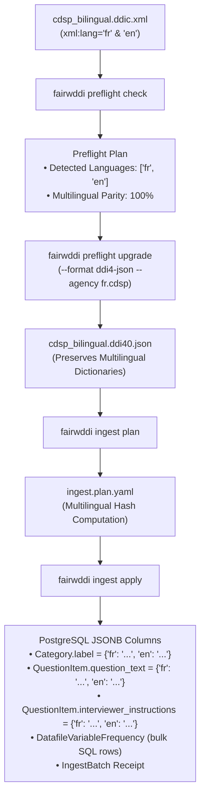
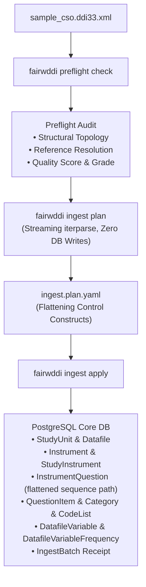

# Operational Guide — Phase 2 Ingestion Workflows

> **Project:** FAIRwDDI WP3 ST3 — Implementation of DDI Architecture for ReQuest  
> **Organization:** Centre des Données Socio-Politiques (CDSP), Sciences Po / CNRS  
> **Target Subsystem:** [`fairwddi.ingest`](file:///Users/pascal/git-plgah/fairwddi-lifecycle/src/fairwddi/ingest/__init__.py)  
> **Status:** Operational Research Deliverable  

---

## 1. Overview of Ingestion Use Cases

The FAIRwDDI Phase 2 ingestion engine supports three primary operational workflows:

1. **Workflow 1: DDI-Codebook Classic (Monolingual):** A standard DDI-C 2.5 XML file documenting one or more data files, with single-language question wordings, variable labels, and code categories.
2. **Workflow 2: DDI-Codebook Multilingual (Bilingual / Trilingual):** A DDI-C 2.5 XML file produced by the `ddi-toolkit` multilingual merge utility (`ddic-i18nmerge`), containing parallel `xml:lang` attributes on `<titl>`, `<labl>`, `<qstnLit>`, `<ivuInstr>`, and `<catgry>`.
3. **Workflow 3: DDI-Lifecycle 3.3 XML (Study Waves & Question Banks):** Complex DDI-L 3.3 XML containing maintainable schemes, question constructs, instruments, sequencing logic, and variable statistics.

---

## 2. Workflow 1: DDI-Codebook Classic (Monolingual)

### 2.1 Use Case & Preconditions
- **Input:** Standard DDI-Codebook 2.5 XML file (e.g. `FSD3562_eng.ddic.xml`).
- **Characteristics:** Monolingual metadata, flat variable listing (`<var>`), embedded question text (`<qstn>`), embedded category statistics (`<catStat>`), and dataset dimensions (`<fileDscr>`).
- **Target:** Upgrade to canonical DDI-L 4.0 on disk, synthesize `ConceptualVariable` $\rightarrow$ `RepresentedVariable` $\rightarrow$ `InstanceVariable`, bulk-insert frequency counts, and record an `IngestBatch` receipt.


### 2.2 Step-by-Step Execution

#### Step 1: Preflight Readiness Check
Audits the DDI-C XML structure, verifies XML well-formedness, inspects study identification, and checks if the file has already been ingested.

```bash
fairwddi preflight check tests/fixtures/FSD3562_eng.ddic.xml \
  --profile request \
  --output-dir ./ingest_output
```

*Expected Output:*
- Emits `./ingest_output/FSD3562_eng.ddic.preflight.plan.yaml` and `.report.md`.
- Summary reports: `specification: DDI-C`, `version: 2.5`, `is_multilingual: false`, `variable_count: 74`.
- If zero errors are reported, `is_ready_to_execute()` evaluates to `True`.

#### Step 2: Explicit DDI-C $\rightarrow$ DDI-L 4.0 Upgrade on Disk
Converts DDI-C into canonical DDI-Lifecycle 4.0 format. Categories and code lists sharing identical response options across variables are automatically deduplicated.

```bash
fairwddi preflight upgrade tests/fixtures/FSD3562_eng.ddic.xml \
  --output ./ingest_output/FSD3562_eng.ddi40.jsonl \
  --format ddi4-jsonl \
  --agency fi.fsd \
  --id-strategy content_hash \
  --harmonize-codes
```

*Key Parameters:*
- `--format ddi4-jsonl`: Emits line-delimited JSON for constant-memory streaming.
- `--id-strategy content_hash`: Mints deterministic URNs derived from normalized resource contents.
- `--harmonize-codes`: Consolidates redundant code lists across survey variables.

#### Step 3: Zero-Write Ingestion Plan
Streams the upgraded `.ddi40.jsonl` file, checks existing URNs in `UrnRegistry`, verifies content hashes for drift detection, and plans core entity allocations.

```bash
fairwddi ingest plan ./ingest_output/FSD3562_eng.ddi40.jsonl \
  --profile request \
  --output-dir ./ingest_output
```

*Expected Output:*
- Emits `./ingest_output/FSD3562_eng.ddi40.ingest.plan.yaml` and `.report.md`.
- Summary registers planned entity counts:
  - `planned_frequency_rows`: Total categorical frequencies to insert.
  - `create`: New entities to insert.
  - `reuse`: Existing identical entities.
  - `quarantine`: Drift conflicts detected.
- Database remains completely unmodified.

#### Step 4: Apply Core Ingestion
Executes the approved plan within an atomic PostgreSQL transaction.

```bash
fairwddi ingest apply ./ingest_output/FSD3562_eng.ddi40.ingest.plan.yaml
```

*What Happens in PostgreSQL:*
1. Inserts `StudyUnit` and `Datafile` records.
2. Creates `Category`, `CodeList`, and `CodeItem` records.
3. Synthesizes `RepresentedVariable` and `InstanceVariable` cascade records.
4. Populates shortcut tables: `QuestionVariable` linking question text to representations.
5. Performs bulk insertion of frequencies: `DatafileVariableFrequency.objects.bulk_create(..., batch_size=1000)`.
6. Creates a single `IngestBatch` receipt row with status `completed`.

#### Step 5: Verification & Inspection
Verify the batch status and entity counts:

```bash
fairwddi ingest status 1
```

*To Roll Back (Undo):*
```bash
fairwddi ingest undo 1
```

### 2.3 Python API Equivalent

```python
from pathlib import Path
from fairwddi.ingest import (
    run_preflight_check,
    upgrade_ddic_to_ddil,
    plan_ingestion,
    apply_ingestion,
    undo_ingestion,
)

src = Path("tests/fixtures/FSD3562_eng.ddic.xml")
out_dir = Path("ingest_output")

# 1. Preflight
preflight = run_preflight_check(src, profile="request", output_dir=out_dir)
assert preflight.is_ready_to_execute()

# 2. Upgrade
upg = upgrade_ddic_to_ddil(
    src,
    output_path=out_dir / f"{src.stem}.ddi40.jsonl",
    output_format="ddi4-jsonl",
    agency="fi.fsd",
    id_strategy="content_hash",
    harmonize_codes=True,
)

# 3. Plan Ingest
ing_plan = plan_ingestion(upg["output_file"], profile="request", output_dir=out_dir)

# 4. Apply
res = apply_ingestion(ing_plan)
print(f"Batch #{res['batch_id']} completed: {res['created_count']} resources created.")
```

---

## 3. Workflow 2: DDI-Codebook Multilingual (Merged fr/en)

### 3.1 Use Case & Preconditions
- **Input:** Multilingual DDI-Codebook 2.5 XML file (e.g. `cdsp_bilingual.ddic.xml`).
- **Origin:** Generated by merging language-specific DDI-C files using `dartfx.ddi.ddicodebook.converters.i18n`. Contains parallel language tags (`xml:lang="fr"`, `xml:lang="en"`).
- **Target:** Preserve ISO 639-1 language dictionaries in PostgreSQL `JSONB`, structure bilingual `QuestionItem` records with interviewer instructions, and populate categorical frequencies.



### 3.2 Step-by-Step Execution

#### Step 1: Preflight & Language Parity Audit
Verifies that all language streams are intact and checks for missing translations.

```bash
fairwddi preflight check cdsp_bilingual.ddic.xml \
  --profile request \
  --output-dir ./ingest_output
```

*Audit Checks Performed:*
- Scans `<titl xml:lang="...">`, `<labl xml:lang="...">`, `<qstnLit xml:lang="...">`, and `<catgry><labl xml:lang="...">`.
- Identifies languages: `languages: ["fr", "en"]`.
- Validates that primary question items have corresponding French and English wordings.

#### Step 2: Multilingual DDI-C $\rightarrow$ DDI-L 4.0 Upgrade
The `ddi-toolkit` converter extracts parallel language elements into standard DDI 4 multilingual structures:

```bash
fairwddi preflight upgrade cdsp_bilingual.ddic.xml \
  --output ./ingest_output/cdsp_bilingual.ddi40.json \
  --format ddi4-json \
  --agency fr.cdsp \
  --id-strategy hierarchical \
  --harmonize-codes
```

*Structure Emitted in DDI 4 JSON:*
```json
{
  "$type": "QuestionItem",
  "URN": "urn:ddi:fr.cdsp:qi_Q1_TRUST:1.0.0",
  "QuestionItemName": [{"String": {"language": "fr", "value": "Q1_TRUST"}}],
  "QuestionText": [
    {"Content": {"language": "fr", "value": "Avez-vous confiance dans le Parlement ?"}},
    {"Content": {"language": "en", "value": "Do you trust the Parliament?"}}
  ],
  "UserAttributePair": [
    {"Key": "ddi:interviewer_instructions", "Value": "{\"fr\": \"Montrer la carte 1\", \"en\": \"Show card 1\"}"}
  ]
}
```

#### Step 3: Plan Direct Ingestion
Inspects multilingual payloads and plans insertions:

```bash
fairwddi ingest plan ./ingest_output/cdsp_bilingual.ddi40.json \
  --profile request \
  --output-dir ./ingest_output
```

#### Step 4: Apply Direct Ingestion
Executes insertion into core PostgreSQL tables:

```bash
fairwddi ingest apply ./ingest_output/cdsp_bilingual.ddi40.json
```

*Database Verification in PostgreSQL:*
All multilingual fields are stored as JSONB objects with ISO 639-1 keys:

```sql
SELECT urn, label FROM request_ddi_category LIMIT 1;
-- Output:
-- urn:ddi:fr.cdsp:cat_yes:1.0.0 | {"en": "Yes, completely", "fr": "Oui, tout à fait"}

SELECT urn, question_text, extended_attributes FROM request_ddi_questionitem LIMIT 1;
-- Output:
-- question_text: {"en": "Do you trust the Parliament?", "fr": "Avez-vous confiance dans le Parlement ?"}
-- extended_attributes: [{"type": "interviewer_instructions", "value": {"en": "Show card 1", "fr": "Montrer la carte 1"}}]
```

---

## 4. Workflow 3: DDI-Lifecycle 3.3 XML (Study Waves & Question Banks)

### 4.1 Use Case & Preconditions
- **Input:** Standard DDI-Lifecycle 3.3 XML file (e.g. `sample_cso.ddi33.xml`).
- **Characteristics:** Deeply nested XML fragments with `<r:URN>`, `<d:QuestionItem>`, `<d:Sequence>`, `<d:QuestionConstruct>`, `<d:Instrument>`, `<l:Category>`, `<l:CodeList>`, and `<p:PhysicalInstance>`.
- **Target:** Direct low-memory XML streaming (`lxml.iterparse`), resolving control construct questionnaires into `InstrumentQuestion` shortcuts, mapping `PhysicalInstance` to `Datafile`, and importing `VariableStatistics`.



### 4.2 Step-by-Step Execution

#### Step 1: Preflight Check & Reference Audit
DDI-Lifecycle documents rely heavily on internal and external reference pointers (`<r:Reference>`). Preflight audits ensure no broken reference chains exist before ingestion:

```bash
fairwddi preflight check tests/fixtures/sample_cso.ddi33.xml \
  --profile request \
  --output-dir ./ingest_output
```

*Preflight Audit Output:*
- Inspects reference targets: ensures all `<r:ID>` and `<r:URN>` references resolve within the package or exist in `UrnRegistry`.
- Computes structural metrics: counts of `QuestionItem`, `Category`, `CodeList`, `Instrument`.
- Evaluates quality metrics: checks for empty labels or missing question wordings.

#### Step 2: Generate Direct Ingestion Plan
DDI-L 3.3 XML does not require pre-conversion; it streams directly into `plan_ingestion()`:

```bash
fairwddi ingest plan tests/fixtures/sample_cso.ddi33.xml \
  --profile request \
  --output-dir ./ingest_output
```

*Flattening Logic Applied During Planning:*
- Detects `Instrument` and following `ControlConstructScheme` / `Sequence`.
- Identifies `QuestionConstruct` references pointing to `QuestionItem`.
- Generates planned `InstrumentQuestion` actions with ordered paths (e.g. `/Instrument/Seq_Main/1`).
- Extracts `VariableStatistics` fragments and plans bulk frequency rows.

#### Step 3: Apply Ingestion
Streams the XML document into PostgreSQL core tables:

```bash
fairwddi ingest apply ./ingest_output/sample_cso.ddi33.ingest.plan.yaml
```

*Core Verification:*
```sql
-- Check Instrument-Question routing shortcut
SELECT i.urn AS instrument, q.urn AS question, iq.path, iq."order"
FROM request_ddi_instrumentquestion iq
JOIN request_ddi_instrument i ON iq.instrument_urn = i.urn
JOIN request_ddi_questionitem q ON iq.question_item_urn = q.urn
ORDER BY iq."order" LIMIT 5;

-- Check categorical response frequencies extracted from VariableStatistics
SELECT datafile_urn, instance_variable_urn, code_value, frequency
FROM request_ddi_datafilevariablefrequency
LIMIT 5;
```

---

## 5. Single-Command End-to-End Orchestrator (`fairwddi ingest run`)

For routine ingestion of trusted files, the `ingest run` command combines preflight, upgrade, plan, and apply into a single automated pipeline:

```bash
fairwddi ingest run tests/fixtures/FSD3562_eng.ddic.xml \
  --profile request \
  --output-dir ./ingest_output \
  --agency fi.fsd \
  --id-strategy hierarchical \
  --harmonize \
  --auto-approve \
  --force-reload
```

### Pipeline Execution Flags

| Flag | Type | Description |
| :--- | :---: | :--- |
| `file_path` | Argument | Path to incoming DDI-C (`.xml`) or DDI-L (`.xml`, `.json`, `.jsonl`) file. |
| `--profile` | Option | Import profile name (default: `request`) or path to custom YAML profile. |
| `--output-dir` | Option | Destination directory for plans, conversion files, and markdown reports. |
| `--agency` | Option | DDI maintenance agency override for URN minting (e.g. `fr.cdsp`, `fi.fsd`). |
| `--id-strategy` | Option | ID strategy: `hierarchical`, `content_hash`, `prefix`, `original`, `uuid`, `sequential`. |
| `--plan-only` | Flag | Generate preflight and ingestion plans without executing database writes. |
| `--harmonize` | Flag | Automatically run candidate discovery and execute approved harmonizations after ingestion. |
| `--force-reload` | Flag | Roll back and replace any existing `IngestBatch` matching this file's SHA-256. |
| `--auto-approve` | Flag | Automatically mark review gates as approved, executing even when warnings exist. |

### Pipeline Return Structure

The pipeline returns a structured execution receipt dictionary:

```python
{
    "status": "completed",
    "batch_id": 42,
    "upgrade_result": {
        "output_file": "./ingest_output/FSD3562_eng.ddi40.json",
        "report_file": "./ingest_output/FSD3562_eng.ddi40.report.md",
        "variable_count": 74,
        "category_count": 312,
        "codelist_count": 48
    },
    "ingest_result": {
        "job_id": "ingest-FSD3562_eng-8f2a1b",
        "batch_id": 42,
        "status": "completed",
        "created_count": 435,
        "reused_count": 12,
        "alias_count": 4,
        "quarantine_count": 0,
        "frequency_rows_count": 418
    },
    "harmonize_result": {
        "job_id": "harmonize-batch42-c3d4e5",
        "merged_multilingual_count": 6,
        "aliased_count": 2,
        "semantic_links_created": 8
    }
}
```
