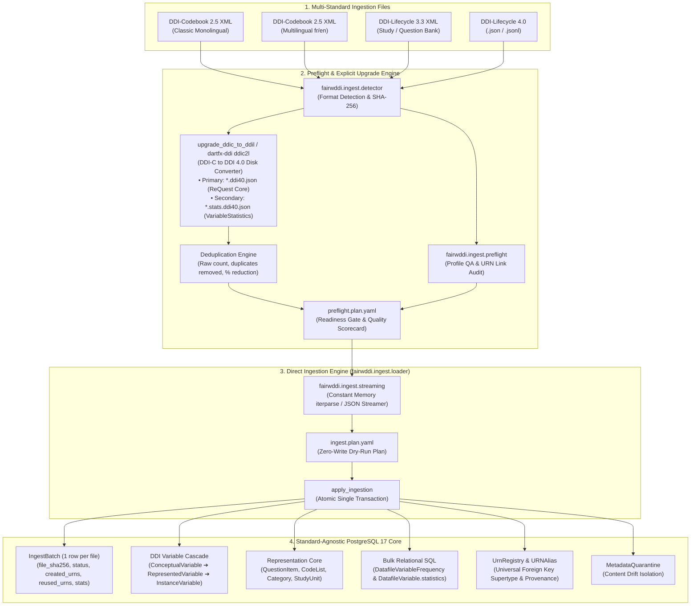

# Executive Summary — Standard-Agnostic DDI Architecture & Decisions (DDI 4 / DDI-CDI / DDI-L)

> **Project:** FAIRwDDI WP3 ST3 — Implementation of DDI Architecture for ReQuest  
> **Organization:** Centre des Données Socio-Politiques (CDSP), Sciences Po / CNRS  
> **Duration:** July 20 – December 18, 2026 (25 days)  
> **Status:** Phase I Architecture & Phase II Ingestion Production Specification Deliverable  

---

## 1. Project Background & Scope

The **ReQuest** platform (`request-ddi`) is a centralized question-bank database maintained by CDSP, serving over **65,000 questions and variables** across **250+ quantitative survey datasets**. 

The goal of this project is to upgrade ReQuest from a legacy pseudo-DDI architecture (DDI-Codebook 2.5 with custom Django abstractions) to a **standard-agnostic DDI architecture** aligned with **DDI 4.0 (COGS model)** and **DDI-CDI (Cross-Domain Integration)**, with full backwards and forwards compatibility for **DDI-Lifecycle 3.3** and multi-standard ingestion.

### Key Scope Principles
1. **Lightweight Profile:** We implement the core DDI variable cascade and representation entities required for the ReQuest question bank without importing monolithic specification bloat.
2. **FAIR & Cross-Standard Interoperability:** Implements persistent DDI URNs (`urn:ddi:fr.cdsp:...`), cross-survey variable cascading (`ConceptualVariable → RepresentedVariable → InstanceVariable`), native multilingual JSONB support (`xml:lang`), and controlled vocabulary concept mapping (e.g. CESSDA ELSST).
3. **Clean Distinction Between Normalization & Harmonization:**
   - **Technical Metadata Normalization:** The automated engineering pipeline (string cleaning, schema standardization, format adapters, SHA-256 fingerprinting, URN generation).
   - **Semantic Harmonization:** The archivist domain workflow (linking variables across survey waves via `ConceptualVariable` and thesaurus URIs).

---

## 2. Master Architectural Decisions & Specifications

---

### A. Database Schema & Domain Model ([`deliverables/research/database.md`](file:///Users/pascal/git-plgah/fairwddi-lifecycle/deliverables/research/database.md))

1. **30-Model Standard-Agnostic PostgreSQL Core (with SQLite Dev/Test Parity):**
   - **Concept Layer:** `ConceptScheme`, `Concept` (generic vocabulary URI anchor, parent hierarchy, notations), `ConceptualVariableScheme`, `ConceptualVariable`, `SemanticRelationship`.
   - **Representation & Instrument Layer:** `QuestionScheme`, `QuestionItem`, `CategoryScheme`, `Category`, `CodeList`, `Code`, `RepresentedVariableScheme`, `RepresentedVariable`, `QuestionVariable`, `Instrument`, `InstrumentQuestion`.
   - **Dataset Layer:** `StudyUnit` (renamed from `Survey`), `InstanceVariableScheme`, `InstanceVariable` (renamed from `BindingSurveyRepresentedVariable`), `Datafile`, `DatafileVariable`, `DatafileVariableFrequency`, `StudyInstrument`.
   - **Organization & Grouping Layer:** `Organization`, `Group`.
   - **Infrastructure & Ingestion Layer:** `UrnRegistry`, `URNAlias`, `MetadataQuarantine`, `IngestBatch`, `EventLog`.
2. **`DDIIdentifiable` Abstract Mixin:** Universal identification mixin providing `urn`, `agency`, `ddi_identifier`, `version`, `content_hash` (primary SHA-256 digest), and `content_hashes` (JSONB multi-algorithm digests).
3. **Structured `QuestionItem` Breakdown:** Extracted from `RepresentedVariable` into explicit multilingual JSONB fields: `question_text` (literal question wording), `pre_question_text` (introductory preamble/routing), `post_question_text` (transition text), and `interviewer_instructions` (guidance).
4. **Decoupled Structural `CodeList`:** Decouples numerical code values (e.g. Code `1`) from response text labels (`Category`). `CodeList` URN is derived purely from structural code-category mappings independent of list title.
5. **Set-Theoretic Schemes (`CategorySet`):** Supports reusable, named category label schemes (`CategorySet`) independent of numerical code assignments.
6. **Dual-Engine Strategy:** Fully ANSI-standard Django schema allowing SQLite for fast local development and sub-second CI testing, and PostgreSQL ≥ 17 for high-concurrency production ingestion and GIN indexing.

---

### B. Ingestion & Multi-Standard Architecture ([`deliverables/research/ingestion_architecture.md`](file:///Users/pascal/git-plgah/fairwddi-lifecycle/deliverables/research/ingestion_architecture.md) & [`deliverables/research/normalization.md`](file:///Users/pascal/git-plgah/fairwddi-lifecycle/deliverables/research/normalization.md))

1. **Standard-Agnostic Core:** Core database tables represent pure DDI domain entities independent of input metadata standards.
2. **Architectural Evolution — Phase 1 Staging vs. Phase 2 Direct Streaming:**
   - *Phase 1 Intermediate Staging Concept:* The preliminary design evaluated breaking down raw XML files into intermediate database rows (`StagedImport` / `StagedResourceNode: raw_urn, raw_value JSONB`).
   - *Phase 2 Benchmarking & Resolution:* Benchmarking on real-world ELIPSS datasets revealed severe database WAL/storage bloat, relational detour overhead for numeric frequencies, and transaction bottlenecks. Phase 2 replaces database staging with a **direct file-to-core streaming ingestion pipeline** (`lxml.iterparse` and `ddi-toolkit` streaming models in constant memory).
3. **Single-Row Operational Receipts (`IngestBatch`):** Intermediate staging tables are replaced with a single audit row per file in `request_ddi_ingestbatch`. It records the source file SHA-256 fingerprint, format, execution duration, and JSON arrays of created URNs, reused URNs, registered aliases, and entity counts.
4. **Decoupled Architecture for Empirical Statistics:**
   - Reusable Question Bank metadata (`StudyUnit`, `LogicalProduct`, `VariableScheme`, `QuestionScheme`, `CodeListScheme`, `CategoryScheme`, `PhysicalInstance`) is saved in the primary `*.ddi40.json` file.
   - Dataset-specific observation statistics (`<catStat>` frequencies, weighted counts, and `<sumStat>` numeric metrics) belong to `PhysicalInstance.StatisticalSummary` pointing to native `VariableStatistics` in a dedicated secondary `*.stats.ddi40.json` file.
   - At database ingestion, categorical frequencies and numeric statistics bypass JSONB and are written directly to `DatafileVariableFrequency` and `DatafileVariable.statistics` using high-speed bulk SQL operations.
5. **Deduplication & Reduction Metrics (`--harmonize-codes`):**
   - The upgrade engine compares code lists and categories across variables, collapsing identical sets into canonical instances.
   - The CLI and upgrade markdown reports compute and display exact reduction metrics: raw count, duplicates removed, and percentage reduction (e.g., 71.1% code list reduction on ELIPSS `movipic2015`).
6. **Declarative Quality Profiling (`request.ddic.yaml`):**
   - Stage 1 preflight evaluates incoming DDI-Codebook files against declarative YAML quality profiles.
   - Enforces required elements (e.g., variables required as fatal errors) and recommended archival best practices (e.g., standalone question items as warnings) with weighted quality scorecards.
7. **Zero-Write Dry-Run Plans & One-Click Rollbacks:**
   - `plan_ingestion` reads disk files, checks existing identities against `UrnRegistry`, and outputs an `ingest.plan.yaml` with zero database writes.
   - Changes are gated by review flags (`requires_review = True`).
   - `apply_ingestion` executes mutations in an atomic single transaction.
   - `undo_ingestion` atomically removes all created URNs via `UrnRegistry` cascading foreign keys, leaving zero orphaned records.
8. **Pluggable & Standalone CLI Tools:**
   - Complete pipeline accessible via `fairwddi preflight`, `fairwddi ingest`, `fairwddi compare`, and `fairwddi harmonize`.
   - Standalone DDI conversion utility available directly in `ddi-toolkit` as `dartfx-ddi ddic2l`, supporting independent DDI-C to DDI 4.0 / DDI 3.3 conversions with code harmonization and secondary statistics export.

---

### C. Content Fingerprinting & Hashing Algorithms ([`deliverables/research/hashing_algorithms.md`](file:///Users/pascal/git-plgah/fairwddi-lifecycle/deliverables/research/hashing_algorithms.md))

1. **Two-Tier Language-Level Hashing:**
   - **Tier 1: Simple Text Hashing (Atomic Level):** `SHA256(canonical_text(label[lang]))` for base text (`Category`, `ConceptualVariable`, `VariableGroup`).
   - **Tier 2: Compound URN Hashing (Structural Level):** Hashes the canonical URNs of child components (`QuestionItem`, `CodeList`, `RepresentedVariable`, `InstanceVariable`). Decouples structure from text re-normalization.
2. **Order-Independent Set-Theoretic Hashing:**
   - **`UnorderedCategorySet`:** Alphabetical sort of Category URNs (`ucs-fr-...`).
   - **`UnorderedCodeList`:** Alphabetical sort of `code_value:category_urn` (`ucl-fr-...`). Detects identical response options regardless of XML element ordering, **eliminating 70% of manual archivist QA false alarms**.
3. **Preferred Algorithm Pattern (`PREFERRED_HASH_STRATEGY`):**
   - Configured via app settings (default: `"v1_strict_sha256"`). Governs canonical URN generation (`DDIIdentifiable.urn` & `content_hash`).
   - Auxiliary strategies (`v2_unordered_set`, `v3_core_text`) are computed in parallel and stored in `DDIIdentifiable.content_hashes` JSONB for multi-index variant lookup and zero-downtime upgrades.
4. **Deterministic Shortened Hash URN Strategy (URL-Shortener / Git Style):**
   - Full SHA-256 (64 hex chars) stored in `content_hash` for cryptographic integrity and drift detection.
   - Canonical URN strings use a **16-character truncated hex** (or 10-char Base62) identifier (e.g. `urn:ddi:fr.cdsp:Category:cat-fr-e7f2b1c4a9d8e5b2:1.0.0`).
   - Guarantees **100% content-based determinism** with zero collision risk ($16^{16} = 18.4 \text{ quintillion}$ combinations) while keeping URNs clean and human-readable.
5. **SHA-256 Default & Pluggable BLAKE3 Benchmark:**
   - SHA-256 retained as default (zero C dependencies, native PostgreSQL `pgcrypto` support, ~25 ms per 100,000 strings).
   - BLAKE3 supported as an opt-in strategy tag (`PREFERRED_HASH_STRATEGY = "v1_blake3"`) for ultra-large batch workloads.

---

### D. Multilingual Architecture & Normalization Cascade ([`deliverables/research/normalization.md`](file:///Users/pascal/git-plgah/fairwddi-lifecycle/deliverables/research/normalization.md) & [`deliverables/research/glossary.md`](file:///Users/pascal/git-plgah/fairwddi-lifecycle/deliverables/research/glossary.md))

1. **4-Phase Normalization Cascade:**
   $$\text{Exact URN Match} \longrightarrow \text{Content Hash Match} \longrightarrow \text{Heuristic ICU Collation Match} \longrightarrow \text{MetadataQuarantine}$$
2. **3-Tier Multilingual Architecture:**
   - **Tier 1 (Non-random URN Match):** Incremental JSONB Dictionary Merge (`{"fr": "...", "en": "..."}`).
   - **Tier 2 (Cross-language Thesaurus):** CESSDA ELSST URI anchoring (`Concept.uri`) at the `ConceptualVariable` level for semantic harmonization.
   - **Tier 3 (Search Discovery):** Elasticsearch 9.4.x multi-field language analyzers (`fr: french_combined_analyzer`, `en: english`).
3. **`URNAlias` Engine & Provenance Audit:** Maps external/random URNs to canonical database URNs while preserving `hash_strategy` and `source_file` audit provenance.

---

## 3. Summary Matrix of Technical Deliverables

| Deliverable File | Path | Key Contents |
| :--- | :--- | :--- |
| **Phase I Audit Report** | [`deliverables/phase1_report.md`](file:///Users/pascal/git-plgah/fairwddi-lifecycle/deliverables/phase1_report.md) | Official Phase I summary report, legacy ReQuest audit, and validated target DDI-L architecture. |
| **Database Schema** | [`deliverables/research/database.md`](file:///Users/pascal/git-plgah/fairwddi-lifecycle/deliverables/research/database.md) | Complete 30-model PostgreSQL 17 schema, ER diagrams, `DDIIdentifiable` mixin, `IngestBatch` receipts, index strategy, zero-data-loss migration path. |
| **Database Explorer & Diagram** | [`deliverables/research/database_diagram.md`](file:///Users/pascal/git-plgah/fairwddi-lifecycle/deliverables/research/database_diagram.md) & [`explorer`](file:///Users/pascal/git-plgah/fairwddi-lifecycle/deliverables/research/database_explorer.html) | Interactive visual browser and comprehensive Mermaid ER diagram of the ReQuest DDI-L core schema with spotlight cascade modes. |
| **Ingestion Architecture** | [`deliverables/research/ingestion_architecture.md`](file:///Users/pascal/git-plgah/fairwddi-lifecycle/deliverables/research/ingestion_architecture.md) | Phase 2 direct file-to-core streaming ingestion specification, decoupled empirical statistics (`*.stats.ddi40.json`), dry-run planning, atomic transactions, and rollback engine. |
| **Ingestion Workflows** | [`deliverables/research/ingestion_workflows.md`](file:///Users/pascal/git-plgah/fairwddi-lifecycle/deliverables/research/ingestion_workflows.md) | Step-by-step procedures for DDI-C to DDI 4.0 upgrade, deduplication tracking, direct database ingestion, review gates, and audit receipt verification. |
| **Ingestion Troubleshooting & QA** | [`deliverables/research/ingestion_troubleshooting_and_qa.md`](file:///Users/pascal/git-plgah/fairwddi-lifecycle/deliverables/research/ingestion_troubleshooting_and_qa.md) | Diagnostic guide for DDI-C/DDI-L errors, validation failures, profile scorecards, missing variables/questions, URI reference validation, and recovery strategies. |
| **Normalization Engine** | [`deliverables/research/normalization.md`](file:///Users/pascal/git-plgah/fairwddi-lifecycle/deliverables/research/normalization.md) | 4-phase cascade, standard-agnostic core, multi-standard format adapters, multilingual 3-tier strategy, architectural complexity evaluation. |
| **Hashing Specification** | [`deliverables/research/hashing_algorithms.md`](file:///Users/pascal/git-plgah/fairwddi-lifecycle/deliverables/research/hashing_algorithms.md) | Master resource-algorithm table, Simple vs. Compound hashing, shortened hash URN strategy, `CategorySet` / `CodeList` set hashing, Preferred Algorithm pattern, worked examples, BLAKE3 benchmark. |
| **Glossary & Terminology** | [`deliverables/research/glossary.md`](file:///Users/pascal/git-plgah/fairwddi-lifecycle/deliverables/research/glossary.md) | Authoritative domain reference mapping DDI-L entities, URN classifications (Authoritative vs. Random vs. Canonical vs. Alias), hashing terminology, ELSST thesaurus, and staging concepts. |
| **Executive Summary** | [`deliverables/research/summary.md`](file:///Users/pascal/git-plgah/fairwddi-lifecycle/deliverables/research/summary.md) | Master executive overview capturing all architectural decisions, design patterns, database schemas, and ingestion workflows. |
| **Variable Cascade Analysis** | [`deliverables/research/variable_cascade_gsim_cdi_vs_ddi_lifecycle.md`](file:///Users/pascal/git-plgah/fairwddi-lifecycle/deliverables/research/variable_cascade_gsim_cdi_vs_ddi_lifecycle.md) | Comparative architectural analysis of variable cascades across GSIM, DDI-CDI, and DDI-Lifecycle 3.3, harmonizing multi-standard representations. |
| **Variable & Question Relationships** | [`deliverables/research/variable_question_relationships.md`](file:///Users/pascal/git-plgah/fairwddi-lifecycle/deliverables/research/variable_question_relationships.md) | Architectural analysis of the 6 canonical relationship paths between variables and questions in DDI-Lifecycle 3.3, DDI-CDI, and ReQuest. |
| **PostgreSQL & Django JSONB Support** | [`deliverables/research/postgres_django_json.md`](file:///Users/pascal/git-plgah/fairwddi-lifecycle/deliverables/research/postgres_django_json.md) | In-depth research report on PostgreSQL JSONB architecture, JSONPath/JSON_TABLE expressions, Django ORM lookups & key transforms (`KT`), subtable unnesting patterns, GIN/B-Tree indexing, and TOAST storage. |
| **CLI User Guide** | [`deliverables/research/cli_user_guide.md`](file:///Users/pascal/git-plgah/fairwddi-lifecycle/deliverables/research/cli_user_guide.md) | Comprehensive manual for the `fairwddi` command-line tools (`preflight`, `ingest`, `compare`, `harmonize`), standalone `dartfx-ddi ddic2l`, database administration, seeding, vocabulary ingestion, and Python APIs. |

