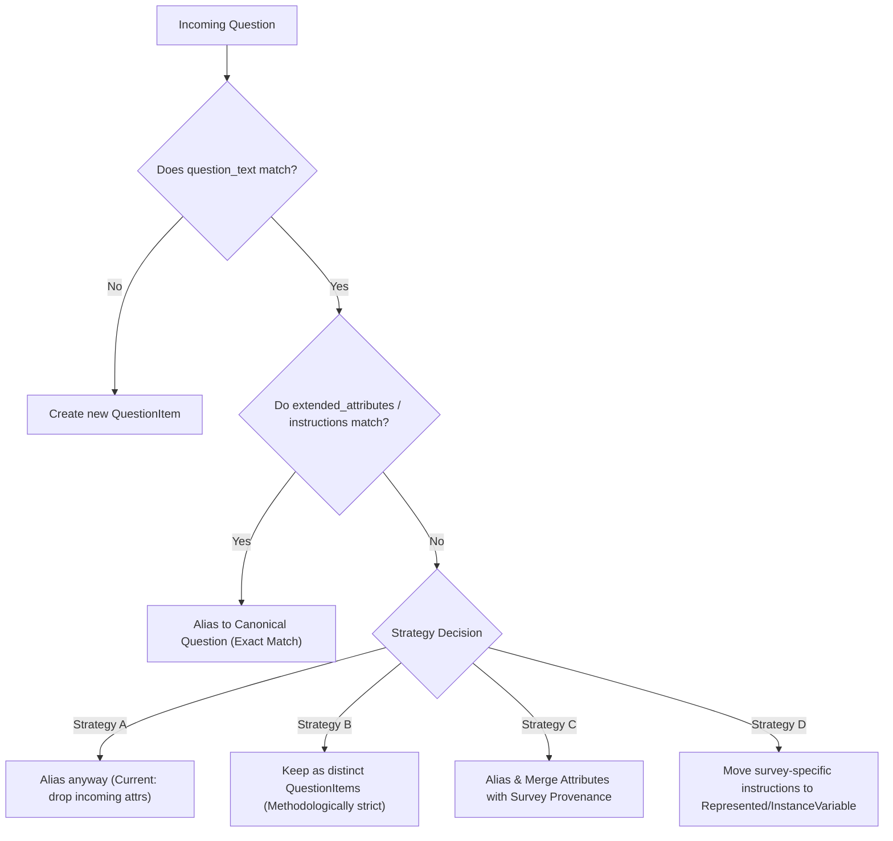

# FAIRwDDI Architecture & Ingestion Design Discussions

> **Project:** FAIRwDDI WP3 ST3 — Implementation of DDI Architecture for ReQuest  
> **Document Purpose:** Agenda and discussion briefing for upcoming CDSP / Sciences Po project team meetings.  
> **Status:** Open for Team Alignment  
> **Date:** November 2026  

---

## Overview

During the implementation of Phase 2 (DDI-Lifecycle ingestion, URN harmonization, and the interactive Question Bank Explorer), two key architectural design decisions have emerged concerning cross-survey entity equivalence:

1. **CodeList Harmonization Timing:** Whether to harmonize identical response domains automatically on ingestion (`ingest execute`), or defer to archivist review gates in Stage 3 (`harmonize execute`).
2. **QuestionItem Equivalence & Extended Attributes:** How to handle questions that share identical literal text but carry different interviewer instructions, pre-question text, or survey-specific extended attributes.

This document details the technical background, current behavior, and options for both topics to support team decision-making.

---

## Topic 1: CodeList Harmonization Timing (Ingest vs. Stage 3)

### Context & Discovery
In longitudinal surveys such as ELIPSS, the same census or demographic variables recur across waves. For example, the INSEE urban typology variable (`insee_TAU2014`) appears across three consecutive annual waves:
- **ELIPSS 2013-04:** `urn:ddi:fr.cdsp:...ea-codelists.cl_V177:3.0.0` (`CL_insee_TAU2014`)
- **ELIPSS 2014-03:** `urn:ddi:fr.cdsp:...ea-codelists.cl_V182:3.0.0` (`CL_insee_TAU2014`)
- **ELIPSS 2015-03:** `urn:ddi:fr.cdsp:...ea-codelists.cl_V195:3.0.0` (`CL_insee_TAU2014`)

All three CodeLists have identical names, identical response codes (`0` to `10`), and point to identical category labels (e.g. `0 -> Commune hors aire urbaine`).

### Current Implementation
- **On Ingest (`fairwddi ingest plan` / `execute`):**
  - **`Category`:** Uses facet hashing on normalized `label`. The category `Commune hors aire urbaine` is deduplicated into a single canonical `Category` record across all three surveys.
  - **`CodeList`:** Evaluated strictly on full `hashes["content"]`. Because each file's incoming CodeList references wave-specific raw Category URNs before remapping, the pre-ingest content hashes differ. Ingestion creates three separate `CodeList` entities (`cl_V177`, `cl_V182`, `cl_V195`), each bound to the shared, deduplicated categories.
- **In Stage 3 (`fairwddi harmonize plan` / `execute`):**
  - The structural comparator evaluates CodeLists across 6 confidence tiers.
  - It identifies `cl_V177`, `cl_V182`, and `cl_V195` as **`FACET_EXACT` (confidence: 0.95)** candidate pairs because their `(code_value, category_label)` pairs match 100%.
  - It recommends registering `URNAlias` and re-pointing `RepresentedVariable` references under an archivist review gate.

### Options for the Project Team

| Option | Ingest Stage (`ingest execute`) | Harmonize Stage (`harmonize execute`) | Pros | Cons |
| :--- | :--- | :--- | :--- | :--- |
| **A. Two-Stage Lifecycle (Current)** | Ingest creates distinct CodeLists per survey wave; references shared categories. | Archivist runs `harmonize plan` to review and approve CodeList aliasing. | Strict provenance preservation; archivist maintains oversight before merging response domains. | Requires explicit harmonization step; CodeLists appear separate in explorer until harmonized. |
| **B. Automated Ingest Aliasing** | Ingest computes a `codes` facet hash (`code_value` + `category_label`); identical domains auto-alias on ingest. | Harmonize only handles partial overlaps (e.g., substantive permutations or category renumbering). | Fully automated cross-wave deduplication out of the box; fewer duplicate CodeLists. | Merges CodeLists without human review; less tolerance for subtle wave differences. |

### Key Discussion Questions for the Team
1. Do data managers want identical response scales to automatically consolidate on ingest, or is human review desired before aliasing code lists across survey waves?
2. If two code lists share categories but use slightly different missing-value conventions (e.g., `99 = Refusal` in wave 1 vs `88 = Don't know, 99 = Refusal` in wave 2), should they remain separate or be flagged for semantic linking?

---

## Topic 2: QuestionItem Equivalence & Extended Attributes

### Context & Technical Mechanics
A `QuestionItem` in DDI 4 / DDI-Lifecycle 3.3 represents the measurement stimulus presented to respondents. In ReQuest, `QuestionItem` contains:
- `name`: Technical identifier (e.g. `qi_V64_q1`)
- `question_text`: Multilingual literal question wording (e.g. `[{"lang": "fr", "value": "..."}]`)
- `extended_attributes`: JSON array holding user attributes, such as:
  - Interviewer instructions (`type: "interviewer_instructions"`)
  - Introductory texts (`type: "pre_question_text"`)
  - Universe statements and filtering conditions

### Current Implementation
In `loader.py:838-856`, QuestionItem auto-aliasing on ingest is evaluated using a **`question_text` facet hash**:
- If an incoming question has the exact same literal wording as an existing question, it is aliased to the canonical `QuestionItem` (`act_type = "alias"`).
- An entry is recorded in `request_ddi_urnalias(alias_urn, canonical_urn)`.
- **Side Effect:** No new `QuestionItem` row is created. The canonical `QuestionItem` retains the `extended_attributes` from whichever survey was ingested first. Any different or additional `extended_attributes` present in subsequent survey waves are not stored on the canonical QuestionItem.

### Methodological Implications
In survey methodology, differing interviewer guidance can fundamentally alter the respondent stimulus:
- **Example 1 (Interviewer guidance):** Survey A asks *"Avez-vous un diplôme ?"* with instruction *"Lire les choix"*, while Survey B uses identical text with instruction *"Attendre la réponse spontanée"*. Methodologically, these produce non-comparable data.
- **Example 2 (Introductory phrasing):** Survey A includes a pre-question routing transition (*"Passons maintenant aux questions sur l'emploi..."*), while Survey B does not.

### Architectural Strategies for the Team



#### Comparison of Strategies

1. **Strategy A: Text-Only Aliasing (Current Implementation)**
   - *Rule:* If literal text matches, alias to canonical question.
   - *Pros:* High deduplication rate; clean, consolidated question lists across multi-wave panels.
   - *Cons:* Subtle differences in interviewer guidance across waves are lost on the `QuestionItem` level.

2. **Strategy B: Composite Facet (`question_text` + `interviewer_instructions`)**
   - *Rule:* Auto-alias only if *both* literal text and interviewer instructions match. If instructions differ, create a new `QuestionItem`.
   - *Pros:* Methodologically rigorous; ensures identical stimulus condition across reused questions.
   - *Cons:* Generates more `QuestionItem` rows; relies on `ConceptualVariable` at the Concept layer to cluster them semantically.

3. **Strategy C: Provenance-Preserving Attribute Merging**
   - *Rule:* Alias to the canonical `QuestionItem`, but append divergent `extended_attributes` tagged with study provenance:
     ```json
     [
       {"type": "interviewer_instructions", "study": "elipss.2013.04", "value": "..."},
       {"type": "interviewer_instructions", "study": "elipss.2014.03", "value": "..."}
     ]
     ```
   - *Pros:* Retains a single canonical question while preserving 100% of wave-specific guidance.
   - *Cons:* Attribute payloads grow over time; queries inspecting instructions must handle multi-study dictionaries.

4. **Strategy D: Separation via the DDI Variable Cascade**
   - *Rule:* Keep `QuestionItem` strictly focused on the reusable wording stimulus. Move survey-specific interviewer instructions and mode notes to `RepresentedVariable` or `InstanceVariable`.
   - *Pros:* Aligns directly with DDI 4.0 / DDI-CDI separation of concerns (stimulus vs realization).
   - *Cons:* Requires parser adjustments to map DDI-L question instructions to the variable layer.

---

## Topic 3: Question Bank Explorer Operational Capabilities

### Enhancements Completed in Phase 2
The interactive explorer web application (`fairwddi explore` / `fairwddi serve`) now features:
1. **Interactive Cascade & Lineage Visualizer:**
   - Visual inspection of the full DDI cascade: `URNAlias -> QuestionItem -> RepresentedVariable -> InstanceVariable -> StudyUnit`, with `CodeList` positioned directly beneath `RepresentedVariable`.
2. **CodeList Explorer:**
   - Dedicated pane inspecting response scales, assigned numerical codes, category labels, missing-value flags, and cross-variable reuse.
3. **Category Explorer:**
   - Multilingual category explorer with survey footprints and wave-tagged CodeList references (e.g. `elipss.2013.04`, `elipss.2014.03`, `elipss.2015.03`).
4. **Performance & Navigation:**
   - Standardized page size of 100 with pagination controls (`‹ Prev`, `Next ›`) and 250ms debounced server-side search across all entities.
   - Deep-linking and bidirectional navigation history (Back / Forward buttons with URL hash synchronization).

---

## Action Items & Next Steps

- [ ] Present CodeList harmonization options (Topic 1) at the technical architecture meeting.
- [ ] Determine CDSP methodological policy on whether interviewer instructions define `QuestionItem` equivalence (Topic 2).
- [ ] Finalize whether provenance-tagged attribute merging (Strategy C) or strict composite facet (Strategy B) is preferred for ReQuest.
- [ ] Schedule demonstration of the Question Bank Explorer for consortium partners.

