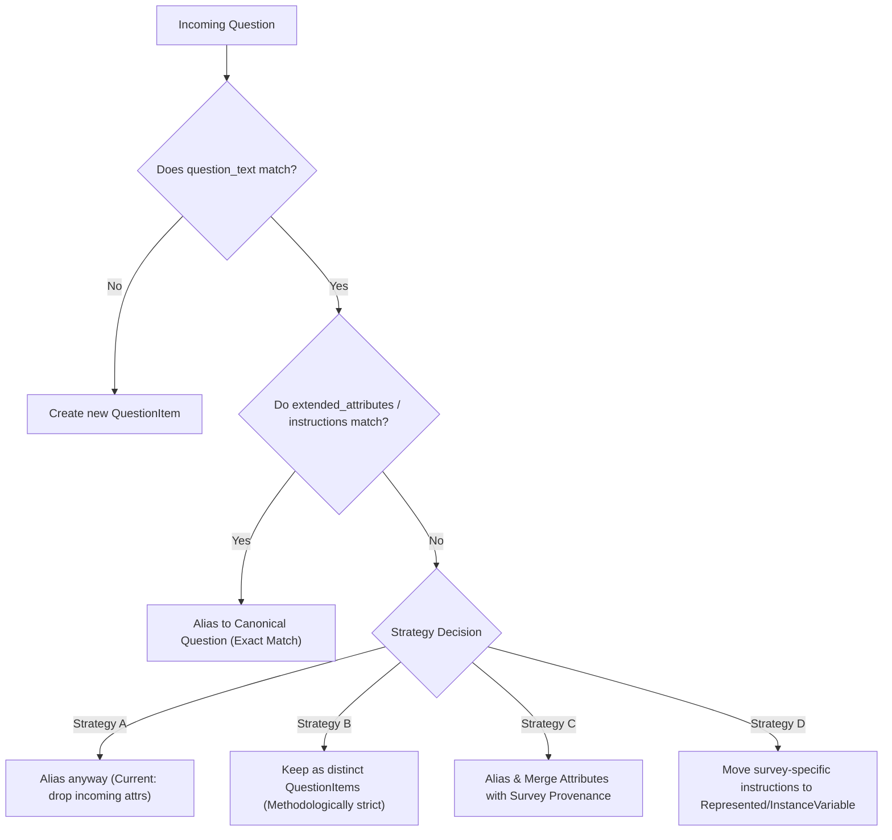
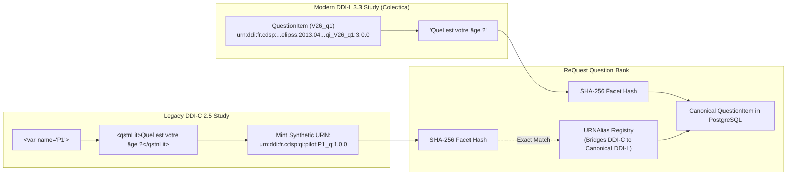
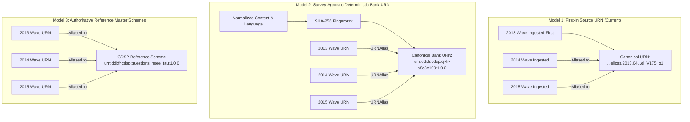
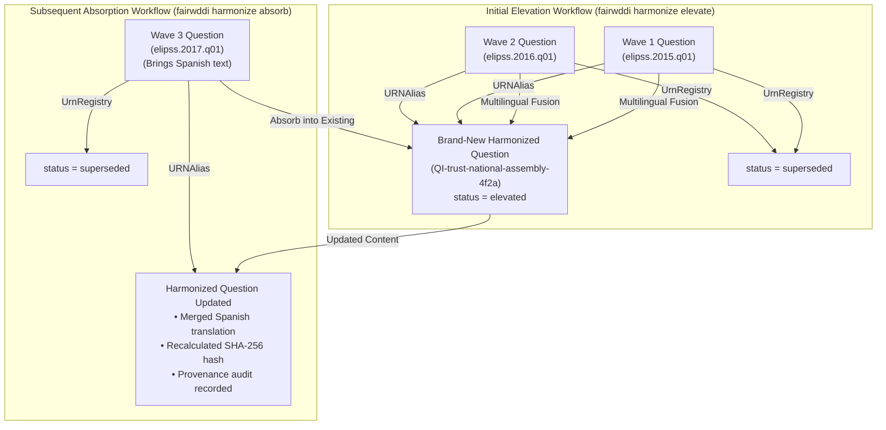

# FAIRwDDI Architecture & Ingestion Design Discussions

> **Project:** FAIRwDDI WP3 ST3 — Implementation of DDI Architecture for ReQuest  
> **Document Purpose:** Agenda and discussion briefing for upcoming CDSP / Sciences Po project team meetings.  
> **Status:** Open for Team Alignment  
> **Date:** November 2026  

---

## Overview

During the implementation of Phase 2 (DDI-Lifecycle ingestion, URN harmonization, and the interactive Question Bank Explorer), four key architectural design decisions have emerged concerning cross-survey entity equivalence, persistent identification, and post-ingestion harmonization:

1. **CodeList Harmonization Timing:** Whether to harmonize identical response domains automatically on ingestion (`ingest execute`), or defer to archivist review gates in Stage 3 (`harmonize execute`).
2. **QuestionItem Equivalence & Extended Attributes:** How to handle questions that share identical literal text but carry different interviewer instructions, pre-question text, or survey-specific extended attributes.
3. **Persistent Identification & Canonical URN Strategy:** How canonical URNs are assigned when identical reusable objects appear across multiple survey waves, resolving the "first-in canonical" dilemma and defining bank-wide URN persistence.
4. **Resource Elevation & Harmonization Helper:** Converting study-specific DDI resources into generic harmonized entities with canonical generic URNs, URNAlias provenance, and cross-cascade reference updates.

This document details the technical background, current behavior, and options for these topics to support team decision-making.

---

## Topic 1: CodeList Harmonization Timing (Ingest vs. Stage 3)

### Context & Discovery
In longitudinal surveys such as ELIPSS, the same census or demographic variables recur across waves. For example, the INSEE urban typology variable (`insee_TAU2014`) appears across three consecutive annual waves:
- **ELIPSS 2013-04:** `urn:ddi:fr.cdsp:...ea-codelists.cl_V177:3.0.0` (`CL_insee_TAU2014`)
- **ELIPSS 2014-03:** `urn:ddi:fr.cdsp:...ea-codelists.cl_V182:3.0.0` (`CL_insee_TAU2014`)
- **ELIPSS 2015-03:** `urn:ddi:fr.cdsp:...ea-codelists.cl_V195:3.0.0` (`CL_insee_TAU2014`)

All three CodeLists have identical names, identical response codes (`0` to `10`), and point to identical category labels (e.g. `0 -> Commune hors aire urbaine`).

### Current Implementation
- **On Ingest (`fairwddi ingest plan` / `execute`):**
  - **`Category`:** Uses facet hashing on normalized `label`. The category `Commune hors aire urbaine` is deduplicated into a single canonical `Category` record across all three surveys.
  - **`CodeList`:** Evaluated strictly on full `hashes["content"]`. Because each file's incoming CodeList references wave-specific raw Category URNs before remapping, the pre-ingest content hashes differ. Ingestion creates three separate `CodeList` entities (`cl_V177`, `cl_V182`, `cl_V195`), each bound to the shared, deduplicated categories.
- **In Stage 3 (`fairwddi harmonize plan` / `execute`):**
  - The structural comparator evaluates CodeLists across 6 confidence tiers.
  - It identifies `cl_V177`, `cl_V182`, and `cl_V195` as **`FACET_EXACT` (confidence: 0.95)** candidate pairs because their `(code_value, category_label)` pairs match 100%.
  - It recommends registering `URNAlias` and re-pointing `RepresentedVariable` references under an archivist review gate.

### Options for the Project Team

| Option | Ingest Stage (`ingest execute`) | Harmonize Stage (`harmonize execute`) | Pros | Cons |
| :--- | :--- | :--- | :--- | :--- |
| **A. Two-Stage Lifecycle (Current)** | Ingest creates distinct CodeLists per survey wave; references shared categories. | Archivist runs `harmonize plan` to review and approve CodeList aliasing. | Strict provenance preservation; archivist maintains oversight before merging response domains. | Requires explicit harmonization step; CodeLists appear separate in explorer until harmonized. |
| **B. Automated Ingest Aliasing** | Ingest computes a `codes` facet hash (`code_value` + `category_label`); identical domains auto-alias on ingest. | Harmonize only handles partial overlaps (e.g., substantive permutations or category renumbering). | Fully automated cross-wave deduplication out of the box; fewer duplicate CodeLists. | Merges CodeLists without human review; less tolerance for subtle wave differences. |

### Key Discussion Questions for the Team
1. Do data managers want identical response scales to automatically consolidate on ingest, or is human review desired before aliasing code lists across survey waves?
2. If two code lists share categories but use slightly different missing-value conventions (e.g., `99 = Refusal` in wave 1 vs `88 = Don't know, 99 = Refusal` in wave 2), should they remain separate or be flagged for semantic linking?

---

## Topic 2: QuestionItem Equivalence & Extended Attributes

### Context & Technical Mechanics
A `QuestionItem` in DDI 4 / DDI-Lifecycle 3.3 represents the measurement stimulus presented to respondents. In ReQuest, `QuestionItem` contains:
- `name`: Technical identifier (e.g. `qi_V64_q1`)
- `question_text`: Multilingual literal question wording (e.g. `[{"lang": "fr", "value": "..."}]`)
- `extended_attributes`: JSON array holding user attributes, such as:
  - Interviewer instructions (`type: "interviewer_instructions"`)
  - Introductory texts (`type: "pre_question_text"`)
  - Universe statements and filtering conditions

### Current Implementation
In `loader.py:838-856`, QuestionItem auto-aliasing on ingest is evaluated using a **`question_text` facet hash**:
- If an incoming question has the exact same literal wording as an existing question, it is aliased to the canonical `QuestionItem` (`act_type = "alias"`).
- An entry is recorded in `request_ddi_urnalias(alias_urn, canonical_urn)`.
- **Side Effect:** No new `QuestionItem` row is created. The canonical `QuestionItem` retains the `extended_attributes` from whichever survey was ingested first. Any different or additional `extended_attributes` present in subsequent survey waves are not stored on the canonical QuestionItem.

### Methodological Implications
In survey methodology, differing interviewer guidance can fundamentally alter the respondent stimulus:
- **Example 1 (Interviewer guidance):** Survey A asks *"Avez-vous un diplôme ?"* with instruction *"Lire les choix"*, while Survey B uses identical text with instruction *"Attendre la réponse spontanée"*. Methodologically, these produce non-comparable data.
- **Example 2 (Introductory phrasing):** Survey A includes a pre-question routing transition (*"Passons maintenant aux questions sur l'emploi..."*), while Survey B does not.

### Architectural Strategies for the Team



#### Comparison of Strategies

1. **Strategy A: Text-Only Aliasing (Current Implementation)**
   - *Rule:* If literal text matches, alias to canonical question.
   - *Pros:* High deduplication rate; clean, consolidated question lists across multi-wave panels.
   - *Cons:* Subtle differences in interviewer guidance across waves are lost on the `QuestionItem` level.

2. **Strategy B: Composite Facet (`question_text` + `interviewer_instructions`)**
   - *Rule:* Auto-alias only if *both* literal text and interviewer instructions match. If instructions differ, create a new `QuestionItem`.
   - *Pros:* Methodologically rigorous; ensures identical stimulus condition across reused questions.
   - *Cons:* Generates more `QuestionItem` rows; relies on `ConceptualVariable` at the Concept layer to cluster them semantically.

3. **Strategy C: Provenance-Preserving Attribute Merging**
   - *Rule:* Alias to the canonical `QuestionItem`, but append divergent `extended_attributes` tagged with study provenance:
     ```json
     [
       {"type": "interviewer_instructions", "study": "elipss.2013.04", "value": "..."},
       {"type": "interviewer_instructions", "study": "elipss.2014.03", "value": "..."}
     ]
     ```
   - *Pros:* Retains a single canonical question while preserving 100% of wave-specific guidance.
   - *Cons:* Attribute payloads grow over time; queries inspecting instructions must handle multi-study dictionaries.

4. **Strategy D: Separation via the DDI Variable Cascade**
   - *Rule:* Keep `QuestionItem` strictly focused on the reusable wording stimulus. Move survey-specific interviewer instructions and mode notes to `RepresentedVariable` or `InstanceVariable`.
   - *Pros:* Aligns directly with DDI 4.0 / DDI-CDI separation of concerns (stimulus vs realization).
   - *Cons:* Requires parser adjustments to map DDI-L question instructions to the variable layer.

---

## Topic 3: Persistent Identification & Canonical URN Strategy

### Context & The "First-In Canonical" Dilemma
Every DDI entity in ReQuest is identified by a persistent Uniform Resource Name conforming to DDI 3.3 / DDI 4 standards:
$$\text{urn:ddi:}\{agency\}:\{identifier\}:\{version\}$$

In the CDSP ELIPSS source files exported from Colectica, entity URNs embed the survey study wave name inside the identifier hierarchy. For instance, the exact same reusable question *"Variable issue du recensement de la population"* carries three distinct URNs in the source files:
- **2013 wave:** `urn:ddi:fr.cdsp:fr.cdsp.ddi.elipss.2013.04.ea-questions.qi_V175_q1:3.0.0`
- **2014 wave:** `urn:ddi:fr.cdsp:fr.cdsp.elipss.ddi.2014.03.ea-questions.qi_V124_q1:3.0.0`
- **2015 wave:** `urn:ddi:fr.cdsp:fr.cdsp.ddi.elipss.2015.03.ea-questions.qi_V133_q1:3.0.0`

### Current Implementation & Observable Side Effects
Under the current ingestion engine:
1. When ELIPSS 2013-04 is ingested first, its URN becomes the **canonical identifier** in PostgreSQL (`request_ddi_questionitem` and `request_ddi_urnregistry`).
2. When 2014 and 2015 are ingested, the system matches their question text and records aliases in `request_ddi_urnalias`:
   - `qi_V124_q1 (2014)` $\rightarrow$ `canonical: qi_V175_q1 (2013.04)`
   - `qi_V133_q1 (2015)` $\rightarrow$ `canonical: qi_V175_q1 (2013.04)`
3. **The Core Issues:**
   - **Ingestion Order Dependency:** If ELIPSS 2015 had been ingested first, the canonical URN for this question would permanently bear the `2015.03` prefix instead.
   - **Semantic Mismatch for Later Surveys:** When a researcher inspects this question in a 2024 survey wave, the canonical bank URN says `elipss.2013.04`, creating the false impression that the 2024 survey depends directly on the 2013 study rather than a neutral, shared question bank.

---

### DDI-Codebook (DDI-C) to DDI-Lifecycle (DDI-L) URN Synthesis & Crosswalk

A critical dimension of the ReQuest migration is bridging **legacy DDI-Codebook 2.5** files (e.g., Nesstar archives, historical CDSP surveys, and Dataverse codebooks) with **DDI-Lifecycle 3.3 / DDI 4**.

#### 1. The Fundamental Identifier Asymmetry
- **DDI-Codebook 2.5:** Has **no native persistent URNs**. Elements are identified only by local XML attributes or variable names (e.g. `<var ID="V1" name="AGE">`) and inline nested tags (`<qstnLit>`, `<catValu>`, `<labl>`).
- **DDI-Lifecycle 3.3 / DDI 4:** Mandates globally unique, persistent DDI URNs across an explicit multi-tier variable cascade (`ConceptualVariable -> RepresentedVariable -> InstanceVariable`).

#### 2. Deterministic URN Minting from DDI-C
When streaming DDI-Codebook 2.5 XML (`stream_ddi_c_xml`), ReQuest synthesizes compliant DDI-L URNs using study metadata:
- **StudyUnit:** Extracted from `<titlStmt><IDNo>` $\rightarrow$ `urn:ddi:fr.cdsp:study:{study_id}:1.0.0`
- **InstanceVariable:** Extracted from `<var ID="..." name="...">` $\rightarrow$ `urn:ddi:fr.cdsp:var:{study_id}:{var_name}:1.0.0`
- **QuestionItem:** Synthesized from question literal or variable name $\rightarrow$ `urn:ddi:fr.cdsp:qi:{study_id}:{var_name}_q:1.0.0`
- **CodeList:** Synthesized from variable's category domain $\rightarrow$ `urn:ddi:fr.cdsp:codelist:{study_id}:{var_name}:1.0.0`
- **Category:** Synthesized from code value $\rightarrow$ `urn:ddi:fr.cdsp:cat:{study_id}:{var_name}-{cat_value}:1.0.0`

#### 3. How DDI-C and DDI-L Align in ReQuest (Content Fingerprint Bridging)
When an older survey wave is ingested from DDI-C and a newer wave is ingested from DDI-L (Colectica):
- Their raw URNs will look completely different (synthetic DDI-C URN vs. Colectica hierarchical URN).
- **The Solution:** The ingestion engine computes SHA-256 facet fingerprints on the normalized text (`question_text` and `label`).
- Because the normalized French text matches 100%, the ingestion engine detects identity and records an entry in `request_ddi_urnalias`:
  $$\text{DDI-C Synthesized URN} \xrightarrow{\text{URNAlias}} \text{Canonical DDI-L URN}$$
- This establishes complete cross-wave harmonization between legacy Codebook studies and modern Lifecycle studies without manual data entry.



#### 4. Round-Trip Export Considerations
- **DDI-C $\rightarrow$ ReQuest $\rightarrow$ DDI-Lifecycle 3.3:** Full fidelity upgrade. Entities synthesized from DDI-C receive standard schemes and can be exported as valid DDI-L 3.3 XML.
- **ReQuest $\rightarrow$ DDI-Codebook 2.5:** Downgrade exporter flattens the 3-tier variable cascade into single `<var>` elements. Canonical DDI URNs are preserved as `<notes type="canonical_urn">` or `<varFormat schema="urn:ddi:...">` attributes for traceability.

---

### Architectural Models for Canonical URN Assignment



#### Detailed Comparison of Candidate Models

| Model | Canonical URN Structure | Ingest Order Dependent? | Strengths | Tradeoffs |
| :--- | :--- | :---: | :--- | :--- |
| **1. First-In Source URN** *(Current)* | `urn:ddi:fr.cdsp:fr.cdsp.ddi.elipss.2013.04.ea-questions.qi_V175_q1:3.0.0` | **Yes** | Preserves exact Colectica/DDI URN verbatim without inventing new identifiers. | Canonical reusable object permanently carries the first survey's wave name. |
| **2. Deterministic Bank URN** *(Recommended)* | `urn:ddi:fr.cdsp:qi-{lang}-{short_hash}:1.0.0` (e.g. `urn:ddi:fr.cdsp:qi-fr-a8c3e109:1.0.0`) | **No** | 100% order-independent; neutral across all waves; deterministic reproducibility. | Canonical URN is generated by ReQuest rather than taken directly from the source XML. |
| **3. Curated Master Schemes** | `urn:ddi:fr.cdsp:questions.{thematic_slug}:1.0.0` (e.g. `urn:ddi:fr.cdsp:questions.insee_tau2014:1.0.0`) | **No** | Semantic, clean, human-readable URNs aligned with CESSDA / ELSST vocabularies. | Requires archivist effort to seed and curate canonical schemes before bulk ingestion. |

---

### Technical Sub-Questions for Team Alignment

#### 1. URN Versioning Lifecycle (`:1.0.0` vs `:3.0.0`)
- Colectica exports from CDSP frequently hardcode `:3.0.0` across all resources.
- If a question's label or interviewer instructions are updated in a later wave, should ReQuest:
  - Increment the minor version (`:3.0.1` or `:1.0.1`)?
  - Mint a new canonical URN if substantive wording changes?
  - Adopt semantic versioning (`MAJOR.MINOR.PATCH`) for bank-managed items?

#### 2. Scope of `UrnRegistry` Master Table
- In the current schema, `request_ddi_urnregistry` is the central master table guaranteeing referential integrity via `ON DELETE CASCADE`.
- *Question:* Should source alias URNs also have entries in `UrnRegistry` with `status = 'aliased'`, or should `UrnRegistry` strictly contain *canonical* resources while `request_ddi_urnalias` handles crosswalk mapping?

#### 3. Display vs Identification
- In the web explorer and API, should the raw URN be prominently surfaced as the main heading, or should UI components emphasize the **Canonical Name + Survey Footprint**, showing the URN in a secondary technical inspector panel?

---

## Topic 4: Question Bank Explorer Operational Capabilities

### Enhancements Completed in Phase 2
The interactive explorer web application (`fairwddi explore` / `fairwddi serve`) now features:
1. **Interactive Cascade & Lineage Visualizer:**
   - Visual inspection of the full DDI cascade: `URNAlias -> QuestionItem -> RepresentedVariable -> InstanceVariable -> StudyUnit`, with `CodeList` positioned directly beneath `RepresentedVariable`.
2. **CodeList Explorer:**
   - Dedicated pane inspecting response scales, assigned numerical codes, category labels, missing-value flags, and cross-variable reuse.
3. **Category Explorer:**
   - Multilingual category explorer with survey footprints and wave-tagged CodeList references (e.g. `elipss.2013.04`, `elipss.2014.03`, `elipss.2015.03`).
4. **Performance & Navigation:**
   - Standardized page size of 100 with pagination controls (`‹ Prev`, `Next ›`) and 250ms debounced server-side search across all entities.
   - Deep-linking and bidirectional navigation history (Back / Forward buttons with URL hash synchronization).

---

## Topic 5: Resource Elevation & Absorption Helpers (`fairwddi harmonize elevate` & `fairwddi harmonize absorb`)

### Context & Need
During metadata ingestion, incoming DDI files mint study-specific URNs anchored to their source dataset (e.g. `urn:ddi:fr.cdsp:elipss_2015_w1.q01:1.0.0`). When an archivist harmonizes questions, variables, or response domains across multiple survey waves or studies, elevating them into a generic, cross-study resource should not retain a study-specific URN, as that causes confusion (e.g., a generic question in a 2024 study appearing to depend on an ELIPSS 2015 wave identifier).

Furthermore, in longitudinal studies, questions and variables are frequently recognized as harmonizable at different points in time:
1. **Initial Harmonization (Elevation):** An archivist compares waves 1 and 2, recognizes two study-specific questions are identical/equivalent, and creates a **brand-new generic resource** (`generic_urn`).
2. **Subsequent Harmonization (Absorption):** At a later time (e.g. upon ingesting wave 3, or discovering an unlinked wave), the archivist finds another study item that belongs to the *already existing* harmonized resource. The archivist needs to **absorb** the new study item into the existing generic resource, merging any new language translations or instructions, updating provenance, repointing references, and retiring the source.



### Application-Level Helper Strategy

#### 1. Elevation Workflow (`fairwddi harmonize elevate`)
- **Creation of a Brand-New Generic Resource:**
  - Rather than mutating an existing study record in-place, creates a new canonical resource with an elevated generic URN (e.g. `urn:ddi:fr.cdsp:QI-trust-national-assembly-7f4c:1.0.0` or `CV-political-trust`).
  - Supports explicit valid canonical DDI URNs or an automated slug-based randomized URN generator (`generate_generic_urn`).
  - Fuses multilingual labels, question texts, and descriptions from all source items, recomputing canonical SHA-256 digests.
  - Registers the new URN in `UrnRegistry` with `status = 'elevated'` and structured provenance in `extended_attributes`.
- **Source URN Aliasing & Retirement:**
  - Each source study-specific URN is registered in `URNAlias` (`alias_urn -> canonical_urn`).
  - Source URNs in `UrnRegistry` are updated to `status = 'superseded'`.
  - Source records in the primary entity table are retired (by default) to keep the active catalog clean.
- **Reference Pointer Consolidation:**
  - Relational pointers across the DDI cascade (`QuestionVariable`, `InstrumentQuestion`, `RepresentedVariable`, `InstanceVariable`, `Code`, `Category`, `Concept`) are updated to point to `generic_urn`.
  - Historical JSONB references (`IngestBatch.created_urns`, `EventLog.event_data`, `MetadataQuarantine`, `extended_attributes`) resolve cleanly through `URNAlias` without destructive document rewriting.

#### 2. Absorption Workflow (`fairwddi harmonize absorb`)
- **Target Integrity & In-Place Enrichment:**
  - Absorbs one or more source items into an *already existing* canonical harmonized resource (`into_urn`).
  - Performs dynamic multilingual fusion: any new translations (e.g. Spanish text on a previously French/English question), interviewer instructions, or extended attributes are merged into the existing target entity.
  - Recomputes SHA-256 content hashes for the target entity.
  - Records structured absorption provenance (`job_id`, `absorbed_urns`, `note`) in both `target_obj.extended_attributes` and `UrnRegistry.extended_attributes`.
- **Reference Repointing & Source Retirement:**
  - Any references pointing to the absorbed sources are repointed to `into_urn` across the DDI cascade.
  - Absorbed source URNs are aliased to `into_urn` in `URNAlias` and set to `status = 'superseded'` in `UrnRegistry`.
- **Target-Preserving Undo (`fairwddi harmonize undo <job_id>`):**
  - Standard elevation undo deletes the generic entity.
  - Absorption undo **preserves the target entity**, rolling it back to its exact pre-absorption attribute state (stripping the absorbed translations/instructions and restoring original hashes), re-creating the retired source items, restoring their active status, and repointing references back.

#### 3. Single-Resource Promotion & Migration (`fairwddi harmonize rename`)
- Atomically renames a study-specific or legacy URN to a clean canonical URN, updating all cascade references and creating an alias in `URNAlias`.

#### 4. Declarative Plan Actions, Wording Curation & Shared-Stem Question Grids
- **Target-Aware `elevate` & `absorb` in `.harmonize.plan.yaml`:**
  - `discover_candidates` and `build_harmonization_plan` inspect whether either resource in a candidate pair is already an elevated generic entity (`UrnRegistry.status == 'elevated'` or `is_elevated: True` in `extended_attributes`).
  - If the target is already elevated, the plan recommends `action: "absorb"` (enriching the existing canonical resource in-place). If both are study-specific, it recommends `action: "elevate"` (or `action: "alias"` for exact/near-exact equivalence).
- **Stratified Similarity & Wording Curation (`requires_review: true`):**
  - `NEAR_EXACT`: Terminal punctuation variants (e.g., trailing `?` or spacing before `?`) and high sequence similarity ($\ge 0.98$).
  - `INCLUSIVE_WRITING_VARIANT` & `PHRASING_VARIANT`: Inclusive markers (`"confronté(e)"` vs. `"confronté"`) and stylistic shifts (`"Je refuse de répondre"` vs. `"Refuse de répondre"`). Keeps the default wording on `question_text`/`label` and preserves alternate phrasings in `extended_attributes` (`type: "wording_variant"`).
  - `TYPOGRAPHICAL_VARIANT`: Grammatical/typographical errors (`"Ma mère..."` vs. `"Mon mère..."`). Keeps the valid wording on the canonical field and drops `discarded_variants` while preserving the source URN in `URNAlias`.
- **Shared-Stem Question Grids (`SHARED_STEM_GRID` & Generic `Group`):**
  - Questions, categories, or variables sharing a common stem followed by distinct choices/sub-items (e.g., `"Êtes-vous confronté(e) à un ou plusieurs des problèmes suivants concernant votre quartier ? Manque d'espaces verts"` vs. `"... ? Manque de sécurité"`) are classified as `SHARED_STEM_GRID` (`action: "group"`, `requires_review: true`).
  - Executing `group` creates or updates a generic `Group` entity (`request_ddi_group` with `group_type="question_grid"`, Shared stem in `description`, and sub-item metadata in `extended_attributes`) and records `ddi:inGroup` relationships in `SemanticRelationship`.

### CLI Interface Summary

```bash
# 1. Elevate two study questions into a new harmonized QuestionItem (auto-slug generated)
uv run fairwddi harmonize elevate \
  -s urn:ddi:fr.cdsp:elipss.2015.q01:1.0.0 \
  -s urn:ddi:fr.cdsp:elipss.2016.q01:1.0.0 \
  --name "Trust in National Assembly"

# 2. Elevate with an explicit canonical target URN
uv run fairwddi harmonize elevate \
  -s urn:ddi:fr.cdsp:elipss.2015.q01:1.0.0 \
  -s urn:ddi:fr.cdsp:elipss.2016.q01:1.0.0 \
  -t urn:ddi:fr.cdsp:QI-trust-national-assembly:1.0.0

# 3. Absorb a newly ingested 2017 wave question into the existing harmonized QuestionItem
uv run fairwddi harmonize absorb \
  -s urn:ddi:fr.cdsp:elipss.2017.q01:1.0.0 \
  -i urn:ddi:fr.cdsp:QI-trust-national-assembly:1.0.0 \
  --note "Wave 3 longitudinal absorption"

# 4. Atomically rename/promote a legacy resource URN
uv run fairwddi harmonize rename \
  urn:ddi:fr.cdsp:legacy_q1:1.0.0 \
  urn:ddi:fr.cdsp:QI-canonical-trust:1.0.0

# 5. Rollback an elevation or absorption job
uv run fairwddi harmonize undo elevate-questionitem-7f2a1b
uv run fairwddi harmonize undo absorb-questionitem-9a0257
```

### Key Discussion Questions for the Team
1. Should superseded study-specific records remain in the database marked as `status = 'superseded'` in `UrnRegistry`, or should they be cleaned from primary tables to minimize active catalog clutter?
2. What slug patterns should be standardized for generic resources across the agency (e.g., `QI-{slug}-{rand}` vs. `{agency}.generic.QI.{slug}`)?
3. For archivist workflows, should elevation and absorption be suggested as recommended actions in `fairwddi harmonize plan` when similarity candidates are discovered?
4. When absorption enriches a target resource with a new language translation, should the target resource increment its version (`1.0.0` $\rightarrow$ `1.1.0`), or remain unchanged with provenance stored in `extended_attributes`?

---

## Action Items & Next Steps

- [ ] **Topic 1:** Decide whether identical CodeLists should auto-alias on ingest (Option B) or remain separate until archivist-reviewed Stage 3 harmonization (Option A).
- [ ] **Topic 2:** Decide methodological policy on `QuestionItem` equivalence: text-only (Strategy A), composite facet with instructions (Strategy B), or provenance-preserving attribute merging (Strategy C).
- [ ] **Topic 3:** Decide canonical URN strategy: retain first-in source URNs (Model 1), adopt deterministic neutral bank URNs (Model 2), or establish curated master schemes (Model 3).
- [ ] **Topic 3:** Validate DDI-C $\rightarrow$ DDI-L synthetic URN naming convention (`urn:ddi:fr.cdsp:{type}:{study_id}:{name}:1.0.0`) and how DDI-C files bridge to DDI-L canonical objects.
- [ ] **Topic 3:** Standardize versioning policy (`:1.0.0` vs `:3.0.0`) for newly synthesized ReQuest canonical entities.
- [ ] **Topic 4:** Schedule demonstration of the Question Bank Explorer for consortium partners.
- [ ] **Topic 5:** Align on archivist elevation & absorption workflows (`fairwddi harmonize elevate`, `fairwddi harmonize absorb`), generic URN slug conventions, and target versioning policies.

